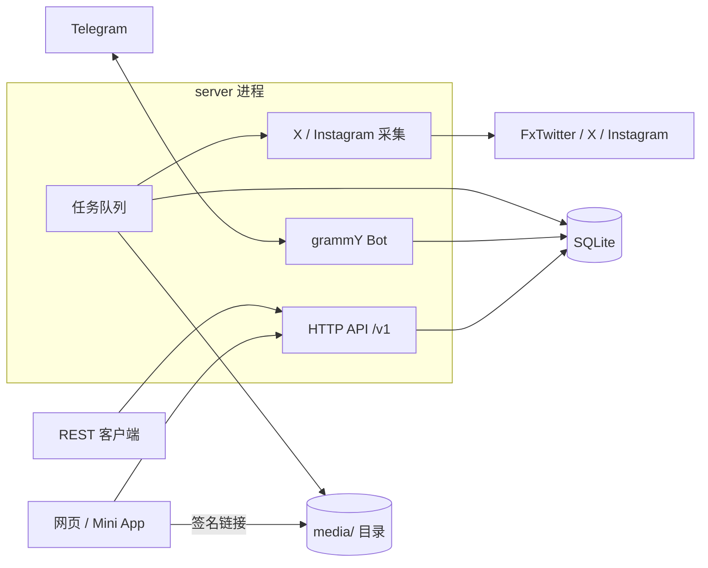

# 架构

Midden 是单用户、单进程的 TypeScript 应用。一个 Node.js 进程同时提供 HTTP API、网页、Telegram Bot、后台任务和采集。

## 代码结构

| 目录                    | 内容                                                                                                  |
| ----------------------- | ----------------------------------------------------------------------------------------------------- |
| `server/src/platforms/` | X 与 Instagram 采集，由旧版 adapter 移植，在进程内直接调用；`third_party/atmosphere` 是其依赖的上游库 |
| `server/src/capture/`   | 采集链路：提交、抓取、下载、缩略图、版本、related 展开与续页、关系网列表、记录与进度、更新、维护      |
| `server/src/library/`   | 读取：收藏详情、筛选列表、作者、版本、删除、标签备注、收藏夹、公开分享、关注变化、关系图谱            |
| `server/src/accounts/`  | 采集账号与加密凭据                                                                                    |
| `server/src/jobs/`      | 存在 SQLite 中的持久化任务队列                                                                        |
| `server/src/blob/`      | 媒体存储接口、本地目录实现、签名链接                                                                  |
| `server/src/http/`      | Hono 路由与认证                                                                                       |
| `server/src/telegram/`  | Bot：命令、消息渲染与分段、投递、媒体发送                                                             |
| `server/drizzle/`       | 由 drizzle-kit 生成的数据库迁移，启动时自动应用                                                       |
| `web/`                  | Vue 网页，构建后由 server 在 `/app/` 提供                                                             |

## 数据

- 一个平台对象（帖子、Profile）对应一条 `collections`；`library` 表示它在收藏库中。每次非刷新的提交都会保存目标，包括 Profile 时间线中的成员和被引用的帖子、账号。
- 新增与更新：提交时在 `submissions.library_added` 记下目标此前是否已在收藏库中且有内容（只有 `library` 行、因抓取失败没有内容的不算已收藏），身份规范化后改到已收藏的对象上时改记为更新。采集记录与 Telegram 进度按此对保存完成的帖子分别计数新增与更新，Profile 时间线中出现在多页的帖子算一次，任一页新增即为新增；有成员早于该列（值为空）时不显示这两项。采集记录详情按此把帖子分为新增记录、更新记录（只含保存完成的帖子）与异常记录（失败与不完整）三栏，有成员早于该列时改为全部与异常记录两栏；另有成员仍在采集时多出进行中一栏，完成后各自移到对应栏。
- 每次抓取是一条 `captures`。内容与最新版本不同时才产生新的 `revisions`；作者资料、计数（点赞数等）、实体编号的变化不算内容变化，平台在实体类型上声明为不稳定（`volatilePaths`，同样的请求时有时无、应用也不显示，如 X 简介的提及 facets 与 `about_account`）的字段也不算。计数随每次抓取保存在 `captures.metrics`。
- 收藏的历史以成功的抓取为点：看起来与前一次成功抓取不同的抓取才成为一个点，连续相同的抓取只保留第一次。比较的是版本中点所显示的部分（`revisions.view_hash`：不含 Profile 时间线记下的转发，它们只用于标记列表中的帖子，而自动刷新不读时间线）和根实体自己的计数（帖子作者、被引用帖子的计数不在这一页显示）。每个点显示它所对应版本的内容和这次抓取的计数，详情页的时间线在这些点之间移动。没有 `view_hash` 的版本按版本本身比较。
- 统计趋势不折叠：`GET /v1/collections/:id/counts` 列出每次成功抓取为根实体记下的计数（按指针，如 `/metadata/followers`），最旧的在前，最多最近 1000 次（`limit` 可取更少，详情页只取 2 次来判断是否有趋势）。至少两次抓取读到同一项计数时，详情页提供「统计趋势」页，每项计数一张折线图。
- 资料修改记录：`GET /v1/collections/:id/profile-changes` 按时间比较 Profile 相邻的版本，列出页面显示的资料（昵称、用户名、简介、受保护、头像、主页封面）有变化的版本，最新的在前，每条给出变化的字段及其前后的值。只比较网页显示的部分，读法与网页相同（简介没有 `description` 时取版本文本）；计数、不稳定字段、时间线记下的转发等不显示的部分不算。图片按内容哈希比较；抓取未能保存的图片、未说明是否受保护的抓取视为未知，不算变化。只比较最近 1000 个版本（`limit` 可取更少的条目）；不是 Profile 的收藏返回空列表。Profile 至少有一条记录时（详情页只取 1 条来判断），详情页提供「资料修改记录」页，按天分组的时间线，最新的在上。
- 实体（帖子、账号）按平台身份共享，`entity_versions` 按内容去重。
- 媒体按 SHA-256 存在 `media/ab/cd/<哈希>`，`blobs` 记录类型与大小，缩略图同样按内容存放。
- 删除收藏后，维护任务在没有进行中的抓取时删除其内容；不再被引用的媒体文件 24 小时后删除。
- `catalog` 为每个有版本的收藏保存列表筛选与排序所需的字段（根实体类型、作者、媒体种类、发布时间、占用空间、搜索文本、账号的粉丝数与关注数等），由最新版本和最新一次带计数的抓取派生，在同一事务内随抓取完成、关注列表存入账号、删除媒体和原始响应清理更新。列表只读这张窄表；作者的最新资料、作者被打的标签、被保存的转发等跨收藏的条件在查询时通过索引计算。启动时会补齐缺失的行，所以改变它的派生方式时，在迁移中清空这张表即可重建；只涉及少数行时（如只有账号才有的计数）也可以在迁移中就地补齐，不必重建全表。
- 列表排序（`sort`）：`updated`（最近一次抓取，默认）、`published`（发帖时间，没有时按抓取时间）、`saved`（加入收藏库的时间）、`storage`（占用空间）、`followers`（粉丝数）、`following`（关注数），`order` 为 `desc`（默认）或 `asc`，相同时按收藏 id 排。翻页位置记下排序值和 id，与筛选条件的指纹一起编码，换了筛选或排序就失效。
- 粉丝数、关注数是账号自己的计数：取这个收藏最新一次带计数（`captures.metrics` 非空）的完成抓取中根实体（`<类型>/<平台 id>`）的 `/metadata/followers`、`/metadata/following`（X 与 Instagram 都放在这里），只认非负整数，其他都算未知。只从关注列表得到、还没抓过的账号，它的第一个版本来自列表，同时有一次带列表所给计数的抓取，所以同样有计数。最新一次抓取完全没有计数时沿用之前读到的，与详情页一致；给了别的计数而缺这一项时算未知。计数存在 `catalog.followers_count`、`following_count`，未知为空；每个方向另有一个虚拟生成列（`<计数>_desc` 为 `coalesce(<计数>, -1)`，`<计数>_asc` 为 `coalesce(<计数>, 2^53-1)`）和它加收藏 id 的索引，所以未知的无论正序倒序都排在最后。用生成列而不是表达式索引，是因为 SQLite 不能在表达式索引上按 `(排序值, id)` 定位翻页位置，每页都要从头扫。这两种排序只在列表只有账号时生效（筛选或公开页访客的 `entity_type` 只含 `.profile` 类型），否则按 `updated` 排：收藏夹的两个标签共用一个保存的排序，帖子标签不应因此出错，网页在帖子标签上也把它显示为更新时间。网页的排序菜单只在账号标签列出「粉丝数」「关注数」，方向写作「从多到少」「从少到多」，列表不按时间分组。

## 删除媒体

- 为节省空间，可以删除帖子的媒体（视频和图片）。被删除的是这条收藏对它的引用，覆盖它所有的抓取和版本，否则空间不会释放。可删除的是内容媒体（`purpose` 为空）和 Profile 的主页封面；头像不删除，同一账号的每条帖子都显示同一个头像。
- 媒体身份：`assets.media_key` 是平台给出的媒体身份（`capture/media-key.ts`），不是地址：X 即不可变键（`x:media:<类型>:<id>`）的哈希，与 `cache_key` 相同；Instagram 的不可变键末尾带有所选的清晰度（类型、尺寸、码率），身份去掉这三段，所以换一个清晰度仍是同一媒体；平台没有给出不可变键时用 `url:<地址>`。迁移按 `cache_key`（没有时按地址）补齐旧的行，因此 Instagram 在此之前保存的媒体只按原清晰度认出。
- 「已移除」标记是 `removed_media(media_key, kind, thumbnail_key, thumbnail_mime)`，按媒体身份，不属于某条收藏。之后任何收藏的抓取（这条帖子的更新，或转发、引用了同一媒体的其他帖子）列出这个媒体时，资产直接记为 `removed`、不排下载任务；标记之前已排队的下载在开始前（等待同一媒体的下载锁之后）再查一次，同样记为 `removed`；已经在下载的照常完成，但资产已不是 `pending` 时文件只在有别的 blob 使用时保留，否则进入 `media_garbage`。`removed` 不算缺失：抓取仍为 `complete`，也不使它成为「没有可保存的内容」。资产不带 blob，所以与删除时一致，删除后再抓取不产生新版本。
- 删除（`POST /v1/media-removals`，`{ ids }` 为若干收藏的全部媒体，最多 500 条；`{ collection, asset }` 为一条收藏中的一个媒体，按这条收藏所有抓取中同一 `media_key` 的资产）在一个事务内：记下标记，把这些资产改为 `removed` 并去掉 `blob_id`，等待它们的下载中抓取重新判断是否可以完成，再释放不再有资产引用的 blob（与删除收藏时的维护相同，`releaseBlobs`：删除 `blobs` 行，文件和缩略图的键进入 `media_garbage`，24 小时后删除），并更新这些收藏的 `catalog`（`storage_bytes` 随之减少，列表的占用合计、`/v1/usage` 同样）。媒体种类筛选仍按平台列出的媒体，删除后帖子仍算有视频。
- 缩略图：`blob_thumbnails` 以 `blob_id` 为键、随 blob 级联删除，所以删除时把这个媒体已有的缩略图的键和类型复制到标记上；维护删除 `media_garbage` 中的键之前，除了 `blobs`、`blob_thumbnails`，也检查是否仍是某个标记的缩略图，是则保留文件。没有缩略图（未配置 ffmpeg 或尚未生成）时标记不带缩略图。
- 试算：`POST /v1/media-removals/preview` 用同一个查询算出删除会做什么：`media`（媒体数，按 `media_key`）、`freed_bytes`（只被这次删除的资产引用的 blob 的大小之和）、`shared`（其 blob 还被其他资产引用、不会释放空间的媒体数）。删除的响应是同样的数字。
- 恢复下载：`POST /v1/media-removals/restore`（`{ collection, asset }`）删除标记，保留的缩略图进入 `media_garbage`；已删除的资产保持 `removed`，下一次抓取重新下载，内容因此不同而产生新版本。
- 接口中删除的媒体 `state` 为 `removed`，带 `kind`，缩略图来自标记（`thumbnail_url`），没有原文件的链接；标记已清除时带 `download_again`。公开接口同样给出。
- 网页：详情页的媒体在查看器右上角有「删除此媒体」；帖子详情在「删除这条收藏」上方有「删除此帖所有媒体」（还有未删除的媒体时）；多选栏右侧「⋯」菜单中有「删除媒体」，对选中的帖子删除其全部媒体，对选中的账号只删除账号自己的媒体。确认面板先读试算，写明「可释放 120 MB」「其他收藏仍在使用，不会释放空间」或两者，没有媒体时写「没有可删除的媒体」。删除的媒体显示保留的缩略图，上面写「视频已移除 · 在原站查看 ›」（或「图片已移除」），链接到帖子在平台上的页面，所以不需要放宽 CSP；所有者的页面另有「恢复下载」，恢复后帖子立即开始一次更新（Profile 在下次更新时），已恢复的写「下次更新时重新下载」。列表的缩略图中显示为带「已移除」的缩略图，点按打开收藏详情。公开页显示相同的遮罩，没有恢复。

## 标签

- 标签是 `tags(id, name)`，名称唯一，收藏通过 `collection_tags` 关联。筛选和收藏夹按 id 引用标签（`tag=<id>`），所以改名只改 `tags.name`。名称去掉首尾空白后不能为空，最多 64 字，创建和改名用同一套校验。
- 列表按标签筛选：`tag=<id>,<id>` 要求带有其中任一标签，加 `tag_mode=all` 时要求全部带有；`not_tag=<id>,<id>` 排除带有其中任一标签的收藏。「带有」包括作者的已保存 Profile 带有这个标签（给账号打的标签覆盖它的帖子），排除也按同样的含义。同一个 id 不能既要求又排除，每个列表最多 100 个。标签集合由 `collection_tags` 的索引查出，6 万条收藏时计数在几十毫秒内。规范化时 id 去重排序，只有一个要求的标签或 `tag_mode=any` 时去掉 `tag_mode`，所以计数缓存和翻页位置不受 id 顺序影响。公开接口不接受也不显示标签条件。
- `PATCH /v1/tags/:id`（`name`）改名。已有别的标签叫这个名字时两者合并，在一个事务内：把收藏移到已有的标签（已同时带两个标签的收藏不重复），把收藏夹筛选的 `tag`、`not_tag` 中的旧 id 换成新 id，去重后重新规范化（合并后同一 id 既要求又排除时保留要求），删除旧标签。响应给出最终的标签、是否合并（`merged`）和新带上该标签的收藏数（`moved`）。按条件缓存的计数随这次写入失效。
- `DELETE /v1/tags/:id` 删除标签及其所有关联，并从收藏夹筛选的 `tag`、`not_tag` 中去掉它；列表空了就去掉这个参数（以及不再有意义的 `tag_mode`），收藏夹因此可能选中更多内容。
- 网页：筛选面板中标签是一排可点的标签，点一次要求，再点一次排除（显示为「非 X」），第三次取消，「全部」清空标签条件；要求两个以上标签时出现「任一 / 全部」。筛选摘要写成「甲、乙」「甲 且 乙」「非 丙」。「标签」旁有「编辑」，打开后点标签可改名或删除。新名称已被别的标签使用时先确认「已有标签「X」，将合并 N 条收藏」，删除也先确认；数量来自 `GET /v1/collections/count?tag=<id>`。之后标签列表、筛选摘要随之更新，当前筛选中被合并的标签换成合并后的 id，被删除的去掉；打开的收藏夹在本地按同样的规则改写，不会显示为已修改。

## 收藏夹

- 收藏夹是保存下来的列表筛选。`folders` 表只存名称和筛选条件，筛选条件就是收藏列表 `GET /v1/collections` 的查询字符串，不含翻页位置和网页的布局，按 `library/filter-query.ts` 规范化（只留筛选与排序参数，去掉空值，键按序，作者排序，标签 id 去重排序），所以新增筛选项不用改表。保存时与列表接口共用解析和校验，列表不接受的条件不能保存。
- 打开收藏夹就是用这组条件显示收藏列表，之后保存的内容符合条件即在其中。手动分组靠标签筛选；收藏夹筛选（要求或排除）的标签即使不再有收藏使用也会保留。
- 收藏夹的条件可以包含任意平台，也可以同时包含帖子和账号：`entity_type` 列出几种类型，或者不写（所有类型）。
- `GET /v1/folders` 给出每个收藏夹在其条件下的收藏数和按根实体类型分开的数量（`types`），与列表用同一套查询；任意条件的同样计数由 `GET /v1/collections/count?<筛选>` 给出。一次计数要读全库（6 万条时几十毫秒），所以计数按条件缓存（不含排序），数据库有写入（`total_changes()` 或 `data_version` 变化）后失效，相对收藏日期换了一天也重新计数；重新计数时每个收藏夹之间让出事件循环，不阻塞其他请求。
- 列表的总数：首页两个标签、收藏夹的每个标签、Profile 的帖子列表和公开列表都在工具栏左侧显示结果总数，帖子写「1,234 条」，账号写「56 个账号」。总数与第一页同时请求（`/collections/count`，公开页用公开的计数接口），不等它就显示列表，翻页不再请求；筛选或标签变化时重新计数，计数返回之前不显示。计数都是精确值：在 6 万条的开发库上，不缓存时最慢的条件（关系筛选的视角账号关注全部 8 千个作者，再加排除标签、帖子类型和搜索）约 48 毫秒，全文搜索约 10 毫秒，排除标签约 28 毫秒，无条件约 21 毫秒。
- 收藏日期可以是相对的：`saved_within=<n>d` 表示包括今天在内的最近 n 个自然日，每次请求按当时的时间重新计算起点，`time_zone`（IANA 时区，默认 UTC）决定「一天」从哪里开始；不能与 `saved_from` / `saved_before` 同时使用，没有 `saved_within` 时规范化会去掉 `time_zone`。绝对日期的条件照旧可用。
- 网页：首页类型标签下方一行列出所有收藏夹和数量，不分当前标签；有筛选时工具栏出现「存为收藏夹」，保存的条件带上当前标签的类型。收藏夹页的地址是 `#/folder/<id>?<筛选>`，筛选用地址栏的形式（本地日期），只有 id 的地址显示收藏夹保存的筛选；条件为空时写成 `entity_type=`，以免被当成只有 id 的地址。收藏夹中帖子和账号分开列出：条件涉及两种类型时，按计数判断结果里实际有几种，两种都有才显示「帖子 / 账号」标签，只有一种时直接列出。所在标签记在地址的 `tab` 中，和布局一样不属于筛选，切换不会让收藏夹显示为已修改。收藏夹的筛选面板多一项「类型」（全部 / 帖子 / 账号）。筛选改动后显示「筛选条件已修改」，可「保存条件」（覆盖收藏夹保存的筛选）或「另存为」；右上角菜单可重命名、删除。
- 快捷日期「今天」「最近 7 天」「最近 30 天」写成 `saved_within=1d` / `7d` / `30d`，网页附上浏览器的时区，与日期框按本地日期计算的含义一致；所以按快捷日期保存的收藏夹总是显示最近的那几天。自定义日期仍是固定日期。收藏夹的时区与浏览器相同时地址中省略。

## 公开分享

- 可以公开一个收藏夹、一个 Profile 或一个帖子。`shares` 表每行是一个公开链接：随机的 `slug`（18 字节随机数，base64url 共 24 个字符，144 位）、目标类型（`folder` 或 `collection`）、目标 id、创建时间和取消时间。同一目标同时只有一个有效链接，再次分享返回它；取消公开只记下取消时间，这一行永远不再有效，重新公开会得到新链接。删除收藏、清空收藏库或删除收藏夹时，同一事务内取消指向它们的链接，所以之后再次保存同一对象也不会让旧链接复活。
- 自定义链接：所有者可以把 `slug` 改成自己取的（`PATCH /v1/shares/:id`，`{slug}`；`null` 换回新的随机 `slug`），只能用小写字母、数字和 `-`，3 到 64 个字符，不能以 `-` 开头或结尾，否则 400。自定义的 `slug` 可以猜到，这是有意的。每个链接只有一个地址：改动后旧 `slug` 立即失效，没有别名或跳转。`slug` 只在有效链接之间唯一（`shares_slug_live`，只覆盖未取消的行的唯一索引），已被其他有效链接使用时返回 409；已取消或已改掉的 `slug` 可以再被使用，届时它指向新的链接，原来的链接仍是取消的。公开接口同样接受随机与自定义两种形式；随机生成的 `slug` 不会恰好是自定义的形式，网页据此判断链接是否自定义。网页的分享面板显示完整链接，有「自定义链接」输入框（输入时检查格式，冲突等错误显示在框下）、复制链接、改回随机链接和取消公开。
- 公开范围在每次请求时按当前数据计算（`library/share-scope.ts`），不冻结成员：
  - 帖子：只有它本身。
  - Profile：它本身，以及详情页下方列出的帖子，即 `related_to=<Profile>`、实体类型为同平台帖子的列表。
  - 收藏夹：收藏夹的筛选条件此刻选中的收藏（之后保存或打标签的内容符合条件即公开，不再符合即失效），加上其中每个 Profile 详情页列出的帖子。判断一个帖子是否属于某个 Profile 时，先按实体身份和别名找出可能列出它的 Profile，再用这个 Profile 的列表查询本身确认，所以结果与详情页一致。
- 公开接口在 `/v1/public/:slug/...`，不需要登录，只能读：分享本身（`GET /v1/public/:slug`：目标类型，收藏夹给出名称和帖子、账号各有多少条，不给出筛选条件）、收藏夹的列表、某个 Profile 的帖子列表（`?related_to=`，只限分享中显示的 Profile）、列表的作者（`/collections/authors`，同样可加 `related_to`）、列表的总数（`/collections/count`，参数与列表相同，范围和访客筛选的叠加与列表一致，按条件缓存）、收藏详情、历史点、统计趋势、资料修改记录、关系网计数、关注变化与关系图谱（不接受 `viewer`）。关系对比和视角账号列表没有公开接口。每个请求先确认 `slug` 有效、目标仍在，再确认所请求的收藏在范围内；不在范围内与不存在、已取消、格式不对一样返回 404 `内容不存在或已删除`。历史点还要求抓取属于该收藏，所以不能借范围内的收藏读别的收藏的抓取。
- 公开列表接受私有列表的筛选与排序参数，只有按标签的 `tag`、`tag_mode`、`not_tag`（会暴露所有者的标签名）、按关系的 `rel_of`、`rel`、`rel_min`（视角账号和它的关注会伸到分享范围之外）和收藏日期的 `saved_from`、`saved_before`、`saved_within`、`time_zone` 不接受，排序只接受 `published`、`updated` 和账号的 `followers`、`following`（粉丝数与关注数是公开资料；`saved`、`storage` 会透露保存时间和相对占用空间，而公开内容不含这两项），带上即 400；其他未知参数同样拒绝。访客的筛选加在收藏夹自己的条件（或 Profile 的帖子列表）之上，只能缩小、不能扩大范围；`entity_type` 也是如此，帖子、账号两个标签就是按它分开的。排序由访客决定，不用收藏夹保存的排序，默认发帖时间从新到旧（账号没有发帖时间，按更新时间）。作者列表只统计这份列表中的收藏，不列出范围外的作者，数量也只按范围内计算。
- 返回内容复用私有接口的读取，只在出口处删减：去掉保存时间、占用空间、实体与版本 id；只有指向范围内收藏的 `saved_collection_id` 保留，其他关联不可在公开页中跳转（网页退回到平台原链接）。引用或转发它的帖子只保留范围内的；范围外的账号只留名称和头像。关注变化和关系图谱中的账号都显示名称和头像，只有范围内的链接到它的收藏。帖子自身版本中的引用帖子和作者属于帖子内容，照常显示。标签、备注、采集记录与进度、账号与凭据、原始响应不在任何公开接口中，也没有写操作。媒体签名链接和头像、封面的平台原图地址（`remote_url`）只随这些删减后的内容给出。
- 公开接口的响应带 `X-Robots-Tag: noindex, nofollow` 和 `Referrer-Policy: no-referrer`；`/app/` 页面带同样的响应头和 `<meta name="robots">`、`<meta name="referrer">`，所以开发服务器上和画在画布上的头像同样不带 Referer。受保护账号照常显示，不另加提示。
- 网页：公开页与私有网页是同一个构建，地址为 `/app/#/s/<slug>`，其下的收藏详情、统计趋势、资料修改记录、关注变化、关系图谱为 `#/s/<slug>/collection/<id>[/stats|/changes|/follows|/graph]`。这些路由不检查登录，读取改走公开接口，指向收藏的链接留在分享内；收藏夹列表和 Profile 的帖子列表有与私有列表相同的筛选，只是没有标签、关系和收藏日期；排序只有发帖时间和更新时间，账号标签另有粉丝数和关注数，默认更新时间从新到旧；作者选项读公开的作者列表。收藏夹列表的筛选、排序和所在标签写在地址的查询中（与首页一样，账号标签写成 `entity_type`），可以直接分享筛选后的页面；Profile 的帖子列表和私有页面一样不写入地址。页面上没有多选、更新、我的整理、删除。敏感媒体默认遮住，访客可以点开或在右上角全部显示，不记住选择。公开页不加载 Telegram 的 Mini App 脚本，访客不会请求 telegram.org；私有网页在路由第一次读取地址之前动态加载它，因为它从地址中读取 Mini App 的启动数据（`tgWebAppData`）。
- 管理：`GET /v1/shares`（加 `collection=<id>` 时只列出使它公开的链接：它自己的、包含它的收藏夹、列出它的 Profile）、`POST /v1/shares`（`target`、`id`）、`DELETE /v1/shares/:id`。收藏夹右上角菜单与收藏详情页有「公开分享」，可创建链接、复制、取消公开；详情页这一行注明已公开，或已随哪个收藏夹、所在账号公开。

## 关系网

- 抓关系网是采集选项之一（`relations`，默认不抓，见「采集选项」），采集链接和更新都可以打开。只对显式提交的 Profile 生效，只在这次采集的第一页提交时请求，续页、继续抓取和「抓取更早的帖子」不再请求；其他目标忽略它。没有单独只抓关系网的入口。
- 每个列表（关注、粉丝）是一条 `relation_fetches`，随请求（`submissions`）创建，等这次主页抓取结束（`deliveries`）后开始。是否抓取按这次抓到的资料里该列表的人数单独判断：超过 5000 人的列表跳过（`skipped`），例如 2 万粉丝、300 关注时只抓关注；资料没有人数也跳过。
- 来源按账号是否受保护选，依据是这次抓到的资料（`protected`），不为此另发请求：公开账号（`protected` 为 `false`）的列表从公共的 FxTwitter 实例读（`https://api.fxtwitter.com/2/profile/id:<id>/followers|following`，每页约 50 人，用上一页的 `cursor.bottom` 翻页），不用采集账号；其余的（受保护或资料没说）用采集账号从 X 读，用这次抓取的账号，否则用当前选中的账号，都没有则失败。来源记在 `relation_fetches.provider_id`（`fxtwitter` / `x-session`，用账号时还有 `connection_id`）。两种来源列出的关注关系同样比较，不区分来源。FxTwitter 对公开账号会稳定地少列几个人（172 人少 1 个、524 人少 9 个），在允许的缺口内；对受保护账号返回 `code 500`，所以从不用它读受保护账号。
- FxTwitter 的任何失败（HTTP 500、404、429、`code` 不是 200、响应不是 JSON）都按暂时错误（UNAVAILABLE）由任务退避重试，从不改用采集账号；429 的 `retry-after` 优先。重试用尽时列表失败，记录中的原因是最后一次的错误，如「FxTwitter 公共接口返回 HTTP 500」。
- 用采集账号读时，每个列表有两个查询：粉丝是 `Followers` 与 `FollowersByUserIDTimeline`，关注是 `Following` 与 `FollowingByUserIDTimeline`，X 分别限流。`Followers`、`Following` 带 `x-client-transaction-id`（由账号的 x.com 页面生成，进程内按账号缓存 10 分钟；`Followers` 不带时返回 404），`*ByUserIDTimeline` 不带。一个查询返回 429 时同一页改用另一个，并记日志（`relations query rate-limited; switching to the other query`）；进程记住各查询的限流结束时间，之后的页先问没有限流的。两个都在限流时等较早的结束时间，这次等待不算任务的尝试次数（`rate-limited` 尾注，任务以 snooze 推迟）。两个查询的 cursor 混用：FxEmbed 的 orchestrator 每页随机选其中一个并沿用上一页的 cursor，没有用 X 直接验证过；切换后若 cursor 不被接受，列表最多读不完（`partial`），不会据此结束关系。
- X 的 GraphQL 与网页接口返回 404 时是「X 接口请求被拒绝」（缺少请求签名或查询已过期，FAILED_PRECONDITION，不重试），不是帖子或账号不存在。
- 抓取是任务 `relations`（`capture` 队列，用采集账号时与同一账号的抓取一次一个）：每次运行最多读 5 页，每页在一个事务里保存，然后作为新任务继续，所以后面页面的限流不会用掉前面页面的重试次数；平台给出的 `retry-after`（X 的限流按 `x-rate-limit-reset` 换算）优先。进度显示在这次更新的采集记录中（「账号」一栏的关注、粉丝两项，列表也是记录的成员），记录在列表抓完前不算结束。
- 列表中的每个账号都成为收藏库中的 Profile（`library` 行，来源与这个主页相同，不另作标记）。还没有任何版本的，用列表里的资料生成第一个版本：一次已完成的抓取，头像、封面记为未下载（`failed`，说明「来自关注列表的资料，未下载图片」），所以以后真实抓取时它们算未知，不会出现假的资料修改；接口在 X 上这类没有下载的头像、主页封面上给出平台的原图地址（`remote_url`，只限 https；Instagram 的图片地址会过期，不给出，网页显示名称首字），网页在收藏列表、详情、作者、关注变化和公开页中直接从平台显示（`referrerpolicy="no-referrer"`），本地保存的图片总是优先；已有版本的账号不动，列表数据不会给真实抓取过的资料添加版本。不为补全资料去请求这些账号。每页的实体、收藏、版本、`catalog` 都按批写入，语句数与页内账号数无关。
- 关注关系存为区间 `follow_edges(follower_id, followee_id, first_seen_at, last_seen_at, ended_at)`，按实体（`entities.id`）而不是收藏记录，任何人的列表中看到的都算：B 出现在 A 的粉丝列表里即 B 关注 A。每对账号最多一个未结束的区间（`follow_edges_open`）；结束后再次看到会新开一行。索引分别服务「X 关注谁」「谁关注 X」与互关。账号的收藏被删除后，有关注关系的实体保留。
- 完整性：只有**完整**的抓取才能结束关系。读到列表末尾、且列出的账号数不少于资料人数减去允许的缺口（10%，至少 5 个，被封禁、停用的账号计入人数但不会列出）时为 `complete`，此时这个列表里在本次开始前没再看到的关系结束（`ended_at`）：A 的完整关注列表里没有 B，A→B 结束；A 的完整粉丝列表里没有 B，B→A 结束。列不全（`partial`）或失败（`failed`）的抓取只记录看到的关系，从不结束任何关系。`relation_fetches` 中每个账号、每个列表最新的 `complete` 记录就是该视角最近一次完整的时间（`relation_fetches_complete`）。
- 关注变化：`GET /v1/collections/:id/follow-changes` 列出账号的新关注、取关、新粉丝、掉粉，最新的在前，最多 1000 条。开始的关系只有在该列表第一次完整抓取之后才算变化（之前的只是起点）；结束总是变化。时间是观察时间：变化发生在 `since`（上一次确认旧状态的抓取）与 `observed_at` 之间。`GET /v1/collections/:id/follows` 给出按已存关系计算的关注、粉丝、互关数，没有任何关系时返回空对象。
- 网页：有关系数据时详情页显示「关系网」关注 / 粉丝 / 互关数，有变化时提供「关注变化」页（`#/collection/<id>/follows`），与资料修改记录同样按天分组的时间线；没有数据时都不显示。三个数字各自链接到收藏库的账号标签，带上下面的关系筛选（公开页中只是数字）。
- 关系筛选：列表参数 `rel_of=<账号>`（视角，与作者相同的稳定身份键 `平台/实体类型/平台 id`，只能是账号类型）和 `rel=following|followers|mutual`（他关注的、关注他的、互关），两者必须同时出现，否则 400。只看未结束的关系（`ended_at IS NULL`）。选中的是这些账号本身和它们发的帖子：条件写在 `catalog.subject_entity_id` 上（帖子是作者，账号是它自己），所以同一个条件在账号标签选 Profile、在帖子标签选帖子，并与其他所有条件（包括标签、`related_to`）叠加。查询从视角账号的实体出发，分别读 `follow_edges_follower`、`follow_edges_followee` 的一段，互关再用 `follow_edges_open` 查反向，结果经 `catalog_subject` 对上收藏，不需要新索引：6 万条收藏、约 4.7 万条关系、视角关注 2700 人 / 粉丝 4500 人时，计数 6–25 毫秒（不带条件的帖子计数约 21 毫秒），一页列表 13–27 毫秒。参数是筛选的一部分，收藏夹按规范化的查询字符串保存它们，计数缓存与翻页位置也随之区分。
- 多个视角：`rel_of` 可以重复（`rel_of=<键>&rel_of=<键>…`，个数不限），`rel` 对每个视角同样适用；`rel_min=<k>`（1 到视角数）要求账号至少与其中 k 个视角有这种关系，两个以上视角时默认 2，一个视角时就是它本身（只能是 1）。`rel_min` 不能单独出现，超出范围、有前导零或不是数字都是 400。互关按每个视角各自判断：至少 k 个视角与它互关。视角本身也可能被选中（A、B 中至少 1 人关注的包括 B，若 A 关注 B）。规范化时视角去重并排序，等于默认值的 `rel_min` 省略，所以同一组条件只有一种写法，收藏夹、计数缓存的键和翻页位置的指纹都随之一致。查询把视角键经 `json_each` 对上 `entities_identity`，按视角读 `follow_edges_follower`（或 `follow_edges_followee`）的一段，按另一端 `GROUP BY` 后 `HAVING count(DISTINCT 视角) >= k`，互关仍用 `follow_edges_open` 查反向，不需要新索引。开发库副本（6 万条收藏）加上合成的关注（20 个视角各关注 3000、被 3000 关注，约 10 万条）：5 个视角的账号计数 3–25 毫秒、帖子计数 4–43 毫秒，20 个视角的账号计数 13–35 毫秒、帖子计数 14–56 毫秒，一页列表与计数相近；k 越大越快。公开接口拒绝 `rel_min`，与 `rel_of`、`rel` 一样。
- 视角账号列表：`GET /v1/collections/perspectives`（`q`、`cursor`，每页 50；`rel_of=<键>`（可重复）只取这些账号，不分页，用于显示已选的名称，此时没有关系数据的账号带 `no_data: true`）只列出**有关系数据**的账号：在 `follow_edges` 任一端出现过，或有 `relation_fetches`。所有者自己的采集账号（未撤销的连接，按平台账号 id 对应实体）排在最前，然后是抓过列表的账号（最近抓取的在前），其余按当前关系数从多到少。名称和用户名取账号已保存 Profile 的版本，没有时取最新的实体版本。每项给出两个列表的抓取情况：最近一次完整抓取的时间（`complete_at`），没有时给最近一次不完整抓取的时间（`partial_at`），都没有即未抓取。只在私有接口中提供。
- 网页：筛选面板的「关系」一节先选视角账号（远程搜索、分页的多选，选项显示名称和 @用户名），选中后出现「他关注的 / 关注他的 / 互关」分段选择（默认他关注的，对所有视角都适用），选了两个以上时还有「至少 k 人」的加减按钮（默认 2，最多视角数）。下面的小字按所选方式说明相关列表的抓取情况：一个视角时如「关注名单 11-20 完整抓取 · 粉丝名单未抓取」，几个视角时每人一行，如「@foo 关注 11-20 完整、粉丝未抓取」：没抓过的列表只是从别人的列表推断出来的。筛选摘要写成「@foo 关注的」「关注 @foo 的」「@foo 互关」，几个视角时「@a、@b、@c 中至少 2 人关注的」「关注 @a、@b 中至少 2 人的」「与 @a、@b 中至少 2 人互关」。地址与列表请求中 `rel_of` 重复出现，默认的 `rel_min` 不写。公开页不提供这一节，地址中的这两个参数也不会发给公开接口。
- 关系图谱：`GET /v1/collections/:id/graph?kinds=following,followers,mutual&limit=300`（`library/follow-graph.ts`）给出以账号为中心的图。节点是中心（第一个）和它此刻（未结束）关注的、关注它的账号，每个账号只属于一类：互关（`mutual`）、只是中心关注它（`following`）、只是它关注中心（`followers`）；`kinds` 选其中几类，不写为全部。每个节点有名称、用户名、头像（同上，可能是平台原图）、它自己最新一次抓取记下的关注数与粉丝数（按平台声明的列表人数指针从 `captures.metrics` 读）、已保存时的收藏 id。账号按粉丝数从多到少排列（没有计数的在后），取前 `limit` 个（默认 300，最多 10000），`total` 是所选几类的总数，`kinds` 是三类各自的数量（与所选无关）。边是这些节点之间此刻的全部关注，`[关注者, 被关注者]` 是节点下标：中心自己的，以及其他账号之间的，所以圈子会聚在一起。其他账号之间的关注来自任何已抓的名单（A 的关注名单、B 的粉丝名单都能得出 A→B），只有抓过名单的账号才有；图谱不为此去抓名单。结束的关注不算。`lists` 给出两个名单最近一次完整抓取的时间（`complete_at`），以及其后部分抓取的时间（`partial_at`）。先用关注者、被关注者两个索引读出中心的关注，再逐个查收藏与最新计数；节点之间的边把节点 id 物化一次后按关注者索引读出，4500 个节点、5 万条边时约 0.2 秒，不另加索引。
- 关系图谱页（`#/collection/<id>/graph`，有关系数据时详情页提供「关系图谱」）：用 sigma.js（WebGL）与 graphology 画，这两个库和页面一起按需加载，不进主包。顶部三个开关「关注」「粉丝」「互关」默认全开，各带数量，切换后按所选重新请求；右侧「图谱 / 列表」切换显示方式；其下一行写名单的完整程度，如「关注名单 11-20 完整抓取 · 粉丝名单未抓取」。
  - 布局按数据选（`graph.ts` 的 `layoutKind`，位置在 `graph-layout.ts`）：通常只抓过中心的名单，边全连着中心，力导向会画成一颗星，所以默认是同心布局：中心居中，由内向外依次是互关、关注、粉丝三圈，位置取自六边形格点，圈的形状是画布比例的圆角矩形，头像紧密排满画布；每圈内粉丝多的在内、从正上方顺时针排。中心以外有其他账号之间关注的账号达到 10%（且至少 3 个）时，这些账号和中心组成核心，用 ForceAtlas2（LinLog，连中心的边权重很低，最后一段按头像大小互斥）在打包的 Web Worker 中排出圈子（库自带的 worker 从 blob 地址启动，被 `/app/` 的 CSP 拒绝），再按头像面积缩放、推开重叠；其余账号仍按三圈排在核心外。
  - 节点是头像（没有头像或是敏感头像时画首字，在右上角全部显示后才画敏感头像），外圈是类别的颜色；大小以布局单位计，随缩放一起变大，按粉丝数取对数只差约三成（0.85–1.15 倍）。X 平台原图地址中的 48px 头像（`_normal`）换成 200px（`_200x200`）。初始视角按全部头像和底行名称取景。桌面有放大、缩小、显示全部三个按钮，触屏双指缩放。
  - 连中心的边只说明类别，圈色已经表示，所以不画；其他账号之间的边清楚地画出（互关不带箭头，单向带箭头）。悬停或点中一个账号时，它、它的邻居和它的边（包括连中心的那条）突出，其余变淡。
  - 名称画在头像下方，由 2D 画布叠在 WebGL 上画（`graph-labels.ts`），不用 sigma 自己的文字：sigma 的字形只取第一页图集，中文名多时（约几百个不同的字，高像素密度屏更少）后面的字从错误的位置取，显示成别的字或两个字叠在一起。名称按「悬停 > 点中 > 中心 > 邻居 > 粉丝数」依次放，放不下（与已放的名称重叠、压到别的头像、头像半径小于 13px）就不写，所以不会重叠；中心、悬停和点中的账号总会写出，衬一块底色。名称截到约头像宽（中文 7 个字）。
  - 列表把同样的账号按互关、关注、粉丝分组，组内粉丝多的在前，每项是头像、名称和粉丝数；点一项弹出同一张卡片。先显示 300 个，「显示更多」每次多 300 个，图谱和列表都有。点中节点在底部弹出卡片：头像、名称、@用户名、关注与粉丝数，已保存时有「以他为中心」（打开那个账号的图谱）和「打开详情」，有用户名（X 也可以是数字 id）时有「打开原文」，在新标签页打开它在平台上的主页；公开页同样有。按住 Cmd/Ctrl 或用中键点节点或列表项，在新标签页打开它的详情（没有保存的账号仍弹出卡片）。设备不支持 WebGL 2 时只有列表。图谱页的「对比」用同一个视角账号选择器（只列有关系数据的账号，不含中心）加选账号，打开中心与它们的关系对比。
  - 标记账号：图谱和关系对比都可以选一个有关系数据的账号作为标记账号（`viewer=<键>`，接口参数同名），每个节点带上它与标记账号此刻的关系：互关（`mutual`）、标记账号关注它（`following`）、它关注标记账号（`follower`），按 `follow_edges_open` 每个节点两次点查，结束的关注不算；响应的 `viewer` 给出标记账号的名称和两个名单的抓取情况。网页把它放在地址的 `viewer` 中，可以直接分享链接；地址没有时默认所有者第一个有关系数据的采集账号（视角账号列表的第一个 `own`），`viewer=`（空）表示不标记。头像右上角画一个标记：互关是实心的心形，标记账号关注它是实心的勾，它关注标记账号是空心圈里一个点，颜色与各类圈色都不同；列表中的头像同样有这个标记。有标记的节点时出现「与 @foo 的关系」开关，打开后其余账号变淡，旁边一行写标记账号的名单抓取情况；卡片多一行「与 @foo 互关」「@foo 关注了 TA」「TA 关注了 @foo」。文字总是写标记账号的 @用户名，即使它是所有者自己的采集账号（所有者可能有几个账号，「你」说不清是哪一个）。没有标记账号或它与这些账号都没有关系时什么都不显示。公开接口拒绝 `viewer`（400），公开页也不显示这些。
- 公开的 Profile 同样有图谱：`GET /v1/public/:slug/collections/:id/graph`，规则与公开的关注变化相同，所有节点都显示名称和头像，只有范围内的收藏保留 `collection_id`，网页只为它们提供跳转。
- 关系对比：`GET /v1/collections/compare?rel_of=<键>&rel_of=<键>…&rel=following|followers&rel_min=<k>&only=<下标,…>&limit=300`（`library/compare.ts`）比较任意多个账号，`rel_of` 的顺序就是显示的顺序，不能重复。`rel` 是比较的一侧（`following`：它们关注的，`followers`：关注它们的，默认前者），`rel_min` 与关系筛选相同（默认 2，一个账号时 1）。响应：`accounts` 是这几个账号（名称、用户名、头像、粉丝与关注数、已保存时的收藏 id、两个名单的抓取情况 `lists`；从未存过的账号只有键和平台 id）；`items` 是与其中至少 k 个有这种关系的账号（被比较的账号本身不算在内，它们的关系在 `edges` 里），每个带 `of`（与之有关系的被比较账号的下标）和粉丝数，按 `of` 的大小、再按粉丝数从多到少排列，取前 `limit` 个（最多 10000），`total` 是总数；`only` 只取恰好与这一组有关系的账号。`combos` 是每种恰好的组合及其账号数，从多到少，不受 `only` 影响。`edges` 是被比较账号与返回账号之间此刻的全部关注，下标指向 `[...accounts, ...items]`。查询把视角物化一次，按视角读关注者（或被关注者）索引的一段，按另一端 `GROUP BY ... HAVING count(DISTINCT 视角) >= k`；只有页面用得到的那几种组合大小才去查粉丝数，所以 k=1、几千个只与一人有关系的账号也只在需要时读。同一份合成数据上 5 个视角 7–24 毫秒、20 个视角 22–50 毫秒（约 5900 个账号）。不去抓名单，只用已存的关系。只在私有接口中提供。
- 关系对比页（`#/compare?rel_of=…&rel_of=…`，可选 `rel`、`rel_min`、`only`、`view=graph`、`viewer`，都在地址里，可以直接分享）：入口是图谱页的「对比」，以及收藏库多选「⋯」菜单中的「比较关系」——选中的账号里有关系数据的达到两个时出现，没有数据的不参与，按钮下写明「N 个账号，M 个没有关系数据」。顶部是被比较账号的头像（各带移除按钮）和「添加账号」（同一个视角账号选择器），下面是它们之间谁关注谁的矩阵和每人一行的名单抓取情况。矩阵的行标题是「关注者」、列标题是「被关注」，左上角写「关注者 → 被关注」；单向关注的格子是 →，互关的两格都是填色的 ⇄，每格的 title 与无障碍名称是整句（「@a 关注了 @b」「@a 与 @b 互关」），对角线空着。矩阵下另列这些关系的句子，互关在前，只列存在的关系；超过 4 个账号时只在手机宽度显示；然后是「关注 / 粉丝」与「至少 k 人」；组合表（UpSet 式）每行用头像圆点表示一种恰好的组合，带数量条和数量，从多到少，先显示 30 行；点一行只看这一组（`only`），再点或点「仅 …」取消。结果有列表和图谱两种：列表每项是头像、名称和与之有关系的被比较账号的小头像；图谱用同一套画布、名称层和头像，被比较账号分开放在一个圆上（两个时左右并排），每种组合的账号以向日葵螺旋聚在相关被比较账号的重心，只与一人有关系的放在那人外侧，再推开重叠，并按画布比例拉伸；共有的账号圈色是紫色，只与一人有关系的用关注或粉丝的颜色。都先显示 300 个，「显示更多」每次多 300 个。点一个账号弹出与图谱相同的卡片，多一行说明它与哪几个被比较账号有关系，如「@a、@b 关注了 TA」。「在收藏库中查看」打开收藏库账号标签，带上等价的多视角关系筛选，可以存为收藏夹（关系筛选包括被比较账号本身，对比页不列出它们，所以数量可能多出几个）。公开页没有这一页。

## 采集选项

- 采集链接（`POST /v1/captures`）和更新（`POST /v1/updates`）用同一套选项 `options`，定义只在 `capture/options.ts` 一处：类型、valibot 校验（`OptionsBody`）和默认值（`DEFAULT_OPTIONS`），两个接口都经 `resolveOptions` 补齐默认值。全部可省略：
  - `posts`：时间线怎么读。`latest`（默认）读最新 `count` 条（默认 100），按时间线列出的帖子计数，不论是否通过筛选；`until_existing` 一页页往下读，直到某一页出现收藏库中已有内容的帖子，再多读一页就停（已有的那条可能只是别人的转发或引用，多读一页免得漏掉中间的帖子），每个 Profile 一次最多读 1000 条帖子（从未抓过的账号没有已有内容可停）；`max` 一直读到有 `count` 条帖子通过筛选，没有 `count` 时读完整条时间线；`none` 只抓资料不抓帖子。`count` 只能与 `latest`、`max` 一起给出（1 到 100000）。
  - `since_days`：只要最近 1、7、30、90 或 365 天发的帖子。天数在这次采集开始时换算成截止时间，存在提交上，续页沿用同一个截止时间；重新采集、再次更新从那时重新换算。时间线从新到旧，所以读过截止时间就不再翻页（`platforms/listing.ts` 的 `pastCutoff`，任何帖子范围都适用）：一页提交完后，页中最后一条已知时间、不是置顶的帖子早于截止时间，就没有下一页；跨过截止时间的那一页照常整页提交（较新的通过筛选），然后停。时间用帖子出现在时间线上的时间（时间线条目的 `listedAt`，转发是转发的时间，不是原帖的发布时间；筛选仍按发布时间）；置顶（`pinned`）不算，时间未知的条目也不算，一页都不知道时间就接着读。这样停下的采集照常完成，不算停止，也不算 1000 条上限停下（没有「继续抓取」）；`until_existing` 遇到已有内容和读过截止时间，先到哪个停在哪个。平台在一页内部翻上游的多页时也按同一规则提前结束（截止时间经 `FetchRequest.since` 传入，取共用这一页的各次采集中最早的截止时间，有一个没有就不传），并返回真实的下一页游标，所以「抓取更多」「抓取更早的帖子」仍从那里接着读。各平台：X 账号读取（UserTweets）按 `TimelinePinEntry` 指令标记置顶，条目时间取时间线上那条推文自己的时间（转推即转推时间），推广条目时间视为未知；X 公开接口不标置顶、转发只有原帖时间，所以每页第一条按可能置顶处理，转发时间视为未知；Instagram 没有转发，条目时间是发布时间，`timeline_pinned_user_ids` 含该账号的帖子是置顶。
  - `media_only`：只要含图片或视频的帖子。
  - `include_shared`：保留引用转帖和纯转发（默认保留）。
  - `capture_references`：采集引用、转发的原帖（默认采集）。关闭时不提交原帖，未保存的原帖保留外链；纯转发就是原帖本身，也一并去掉。单个帖子只用这一项。
  - `relations`：抓关系网（默认不抓），即「关系网」一节的关注、粉丝列表，超过 5000 人的列表跳过。
- 上限都是软的：一页总是整页提交，因为下一页从它之后开始，截掉的帖子就再也读不到了，所以可能略多于设定的条数。
- 补齐后的选项存在每条提交的 `submissions.capture_options` 上（加上换算出的截止时间，以及 `until_existing` 遇到已有内容后标记最后一页的 `finalPage`），续页和成员沿用父提交的选项，记录据此给出 `options`（与请求同样的字段），记录页显示一行摘要，如「仅媒体 · 最近 7 天 · 抓关系网」，只列与默认不同、且对目标有意义的项（帖子只看原帖一项）；什么都没改时 Profile 写出帖子范围（「最新 100 条」），帖子不显示这一行。
- `until_existing` 读满 1000 条（读到该页结束）仍未遇到已有内容时，最后一页记下 `submissions.timeline_capped`，它的下一页游标就是接着读的位置；先遇到已有内容（哪怕同时满了 1000 条）不算。从这个游标接着读（`continuePages`）用同样的选项，再读最多 1000 条，新页面按时间线续页的键 `batch:<上一页>` 提交并接在上一页之后，所以计入同一条记录。采集链接的记录给出 `pages.capped`，用 `POST /v1/captures/:id/pages`（`op: 'continue'`）继续；更新的记录见下节。
- 采集记录的「抓取更多」（`op: 'more'`）和「抓取 1000 条」（`more1000`）从最后一页往后读 100 条、1000 条，沿用原来的筛选，作为新记录；「重试本页」（`page_retry`）以原选项重读最后一页。
- 开始采集的各个入口：网页的采集链接表单、更新面板（帖子详情和 Profile 详情的「更新」、收藏夹菜单的「更新收藏夹」、多选的「更新」）由用户选择，每次打开都是默认值；Bot 发来的链接和 Bot 的「更新」（`/refresh`）、Bot 的 `/retry`、恢复下载后立即的重新采集、「抓取更早的帖子」用默认值；「重新采集」「再次更新」沿用原记录的选项，日期范围从现在重新换算；继续抓取沿用原来的选项。

## 更新

- 「更新」把已保存的内容重新抓一遍：一个帖子、一个 Profile、一个收藏夹或收藏库中选中的若干条（最多 500 条）。接口是 `POST /v1/updates`，`target` 为 `{ target: 'collection' | 'folder', id }` 或 `{ target: 'many', ids }`，`options` 是上节的采集选项，每一条都像以同样选项提交链接一样重新抓取（帖子只用 `capture_references`）；选项与 `older` 存在 `updates.options`、`updates.older` 上。`older: true` 从上一次读到的最后一页之后接着读（只用于单个 Profile，帖子范围不能是 `none`，没有下一页时返回「没有更多帖子了」），按选项读多少、怎么筛选。
- 每次更新是一行 `updates`，开始时把目标展开成收藏 id 列表（收藏夹按此刻的筛选条件，最多 10000 条；之后才保存的内容不在其中），每条收藏只更新一次。任务 `update`（`control` 队列）按顺序逐条提交，同时进行中的（抓取未结束或时间线仍在提交成员）不超过 5 条，满了就过几秒再来，所以大的收藏夹不会一下子塞满队列；已提交到第几条记在 `position`，重放不会重复提交。轮到时已被删除或无法抓取的收藏计入 `skipped`。帖子照常重新抓取；Profile 带着同样的选项重新抓取。
- 每条被提交的请求（`submissions.update_id`，键为 `update:<更新>:<位置>`）是这次更新的成员，不单独成为采集记录：一次更新只有一条记录，记录 id 就是更新的 id，`GET /v1/captures`、`/v1/captures/:id`、`/members`、`/retry`、`/retry-failed`、`/stop` 都接受它。成员是更新的帖子与 Profile、Profile 时间线中的帖子和关注、粉丝列表；同一条收藏既被更新又出现在时间线中只算一次（取最新的那次抓取，任一次为新增即为新增）。新增、更新、异常、进行中按全部成员计数，尚未轮到的收藏计入进行中。记录还给出目标（`update`：类型、收藏夹名称、单个 Profile 的用户名、帖子与账号各几条、是否 `older`）、这次的选项（`options`）和每个 Profile 的各部分进度（`profiles`，最多前 200 个）：资料抓取的状态、时间线帖子已完成数与总数、关注和粉丝列表的状态。重试失败的成员留在同一条记录里；「再次更新」以同样的目标和选项开始一次新的更新。
- `until_existing` 被 1000 条上限停下的账号（见上节），`profiles` 中的 `posts.capped` 为真。`POST /v1/updates/:id/continue`（`{ collection_id }`）从停下的游标以同样的选项接着读，它的帖子是同一次更新的成员，计入同一条记录，记录回到进行中。已中止的更新不能继续。之后的 `older` 从这个 Profile 最近读到的一页往后读，也就是续读停下的位置。
- `POST /v1/updates/preview` 给出目标中帖子和账号各几条、能抓关系网的账号数，单个 Profile 还有上次抓到的关注、粉丝人数和是否还有更早的帖子，供更新面板显示。`GET /v1/collections/:id/update` 给出这条收藏最近一次更新（进行中，或开始不到 24 小时）和是否还有更早的帖子。
- Bot 的「更新」按钮（`/refresh`）同样开始一次更新，进度消息跟随这次更新的那条请求，「在小程序查看进度」打开更新的记录。
- 网页：采集链接表单和更新面板用同一个选项组件（`CaptureOptions.vue`），默认值相同。采集链接表单里它折叠成一行「采集选项」，右侧是摘要（与记录页的摘要同一个函数），展开后列出全部选项。帖子详情和 Profile 详情的「更新」、收藏夹右上角菜单的「更新收藏夹」、多选工具栏的「更新」打开同一个更新面板，标题写明范围（「更新 @foo」「更新 12 个账号、340 条帖子」），只显示对目标有意义的选项：目标中有账号时才有「抓帖子」及其子项（帖子范围：最新 / 抓到已有数据为止 / 最多 / 全部，最新和最多有条数；发帖日期、仅媒体、包含转帖）和「抓关系网」（平台能读名单时；单个账号显示关注、粉丝人数，超过 5000 的写明将跳过）；「采集原帖」在有单个帖子或抓帖子打开时出现；单个帖子只有这一项。子选项只在上级打开时出现。开始后提示「已开始更新」，详情页的更新一组变为「正在更新…」并出现「查看进度」，打开这次更新的记录；更新结束后详情页重新读取内容。Profile 的帖子列表读到底时有「抓取更早的帖子」。记录页标题写明目标（「更新 @foo」「更新收藏夹「猫」」「更新 12 项」），顶部是进度条和计数，有账号时上方列出每个账号，如 `@foo  资料 ✓ · 帖子 34/100 · 关注 ✓ · 粉丝 跳过`；被 1000 条上限停下的账号写成「帖子 1000（未到已有数据）」，下面有「继续抓取」，在这条记录里接着读（采集链接的记录同样有「继续抓取」）；概况里「选项」一行是这次采集的选项摘要；再下面是新增、更新、异常、进行中各栏。

## 删除

- `POST /v1/collections/delete`（`ids`、`with_posts`、`dry_run`）在一个事务内把多条收藏移出收藏库，与单条删除（`DELETE /v1/collections/:id`、Telegram `/delete`）共用 `deleteCollections`：删除 `library` 行，清理不再使用的标签（`pruneTags`），取消指向它们的公开链接（`revokeOrphanedShares`），标记为未引用（之后由维护任务删除内容）。不在收藏库中的 id 跳过，全都不在时 404。`dry_run` 只计数，不做任何改动，返回的计数与实际删除相同：`profiles`（选中的账号）、`posts`（选中的其他收藏）、`related`（随账号删除的帖子）和 `kept`（随账号保留的帖子，每条按第一个成立的原因计一次）。id 列表经 `json_each` 传入，不受绑定参数个数的限制。
- `with_posts`：同时删除选中账号的帖子。账号的帖子是详情页下方列出的那些（`relatedEdgesSQL`，同平台的帖子：他发的，包括他的引用帖；他转发的；提及他的）中他发的和他转发的，加上他发的帖子引用或转发的帖子；只是提及他的帖子不算他的，不随他删除。其中一条只有在下面都不成立时才删除，否则保留并计入对应原因：
  - `listed`（其他账号也关联）：留在收藏库中的另一个已保存账号的详情页也列出它，即它是那个账号发的、被那个账号转发的，或提及那个账号。提及仍算关联：他发的帖子提及了留下的已保存账号就保留，只提及其他人（包括这次一起删除的账号）则照常删除。只在这次一起删除的账号之间共有的帖子照常删除。
  - `saved`（单独收藏）：它曾被单独提交过，即有一条属于它的采集记录（顶层、有输入、不是流水线自己的提交）且不是刷新。更新（`updates`）的成员不是自己的记录；更早的刷新按批量刷新的 `refresh-batch:` 键，或作为为刷新而建的抓取（`captures.refresh_from`）的第一条提交来识别；加入了正在进行的抓取的刷新，以及加入正在刷新的抓取的保存，都算作保存。没有任何提交指向的收藏无法分辨来源，也保留。
  - `annotated`（已整理）：有标签或备注。
  - `quoted`（被其他帖子引用）：留在收藏库中的另一条收藏的最新版本引用或转发它（删掉会让那条收藏的引用无从显示）；保留一条可能使它引用的帖子也保留，反复计算直到不再变化。
- 实现：选中的收藏和候选帖子放在临时表中，各条规则都是对整批候选的一条语句，不逐条循环。`listed` 从候选一侧反查 `relatedEdgesSQL` 的三种关系，与账号详情页的列表一致。开发库（6 万条收藏）中一个有 5084 条帖子的账号：预演约 140 毫秒，删除约 170 毫秒；8084 条帖子、九成只来自时间线时，预演约 230 毫秒，删除约 270 毫秒；一次删除全部 92 个账号约 260 毫秒。
- 旧版导入的数据：提交按原样导入，保留了 `parent_submission` 和键，时间线和引用带来的帖子有父提交，单独提交的帖子是顶层记录，所以同样能分辨；Telegram `/show` 留下的顶层提交没有输入，不算保存。旧版的单条刷新同样记在 `captures.refresh_from`。
- 网页：列表工具栏的「多选」进入选择，底部工具栏左侧是「取消」，中间是已选数量和「全选」（全部选中时为「取消全选」），右侧是「更新」和「⋯」，选中后两者可用；「⋯」打开的菜单中有「删除媒体」和红色的「删除」，各自打开原有的确认面板。「删除」与详情页的「删除这条收藏」打开同一个确认面板，先预演一次（带上账号的帖子）再显示确切数量，如「将删除 3 个账号、2 条帖子」；选中账号时有「同时删除关联的帖子」，默认不勾，勾选后写成「将删除 3 个账号、412 条帖子（保留 37 条：其他账号也关联 12 条、单独收藏 20 条、已整理 5 条）」。删除后选择结束；带上帖子时各列表重新读取，因为删了哪些帖子只有服务端知道。

## 任务

任务保存在 `jobs` 表，按队列限制并发：`capture` 4、`download` 8（缩略图共用，优先级较低）、`control` 4。失败按 2、4、8… 秒退避，最多 3 次；平台给出的 `retry-after` 优先；无法通过重试解决的错误直接失败。进程重启时，运行中的任务回到队列。

抓取的状态在结果保存前一直是 `queued`，所以它本身分不出排队与正在抓取。采集记录、成员列表、`GET /v1/jobs/:id` 和 Telegram 按抓取任务在 `jobs` 中的状态区分：任务尚未运行时给出 `waiting`（`queue`：等待空闲的并发位置或账号；`retry`：失败后等待重试），网页显示「排队中」「等待重试」，否则显示「正在采集」。

## 媒体链接

API 返回的媒体带有限时签名链接（`/media/<哈希>?e=…&t=…&s=…`），浏览器直接请求，不依赖登录 Cookie。链接在 12 小时的时间窗内保持不变，便于浏览器缓存。`BlobStore` 是可替换的接口，将来可以加入 S3 等远端实现，届时由它返回远端的预签名链接。

## 网页导航

- 网页内去往另一页的地方都是带 `href` 的链接（`#/…`，由 `router.resolve` 得出），所以 Cmd/Ctrl 点击、中键、右键菜单「在新标签页打开」和状态栏地址都与普通链接一样。`ui/AppLink.vue` 是共用的链接：`to` 是路由，`href` 是地址，指向别的网站时加 `target="_blank" rel="noopener noreferrer"`；普通点击经路由跳转，其余点击交给浏览器，与 RouterLink 相同。`ListButton` 等有 `to` 时渲染成这样的链接；收藏列表的一行整体是标题链接的点击区域，行内的头像、引用和媒体在它之上。`返回`（`ui/BackLink.vue`）是指向它去处的链接：通常是历史中的上一页（后退），去处的规则见下面的标签状态；没有历史时是所在标签的根页（公开页是分享首页）。
- 只在操作完成后才知道去处的跳转（存为收藏夹后打开、重新采集后打开新记录、删除后回到列表）、表单提交和只改当前页状态的 `router.replace` 仍由代码执行。lint 规则 `midden/no-click-navigation`（`scripts/no-click-navigation.ts`）在 `.vue` 的事件处理中发现同步的 `router.push` 或修改 `location`（包括经由组件内的函数）时报错；`async` 函数、`submit` 与 `search` 事件不算。
- 图谱画布上的节点不是元素：Cmd/Ctrl/Shift 点击或中键时用 `window.open` 在新标签页打开它的详情。
- Mini App 中没有标签页，新开的浏览器窗口也没有登录：修饰键和中键点击都在当前页打开（`navigation.ts` 的 `navigatesHere`），文档上的 `click`、`auxclick` 监听处理普通的 `#/` 链接。
- 底部标签栏（`TabBar.vue`，规则在 `tabbar.ts`）：所有者的每一页都有，公开页、登录页和 `/passkey` 页没有。三个标签都是链接：「探索」（收藏库）、「关系」（`#/relations`）、「设置」（`#/settings`），各自回到离开时的页面（见下）。页面属于哪个标签只看路由：收藏库及从它打开的收藏详情、统计、资料修改记录、关注变化、采集与采集记录属于探索；`#/relations`、Profile 的关系图谱与关系对比属于关系；设置及其子页属于设置。所在标签高亮；在标签的根页再点它回到顶部，在更深的页面点它回到根页（离开时的筛选和帖子或账号标签）。手机上页面向下滚动 12px 后标签栏移出屏幕，向上滚动同样距离后回来，在顶部和滚到底时总是显示；换页后 0.4 秒内的滚动和恢复位置时的滚动不算。桌面（`(hover: hover) and (pointer: fine) and (min-width: 900px)`，`tabbar.ts` 的 `DESKTOP`）上标签栏一直显示，各项在与页面同宽（960px）的内容栏中横排，图标在标签左边，有悬停样式，当前标签用链接色。多选时由多选栏取代它。高度加上 `env(safe-area-inset-bottom)`，Mini App 中改用 Telegram 给出的 `--tg-safe-area-inset-bottom` 与 `--tg-content-safe-area-inset-bottom`（取较大者）；页面底部留出它的高度，提示条在它显示时上移，图谱画布的高度扣除它。顶栏只有「返回」（不在标签根页时，Mini App 中由 Telegram 的返回按钮代替）、标题和本页的操作；探索的顶栏保留「采集」（采集链接与采集记录）。没有历史时「返回」回到所在标签的根页。
- 标签状态（`tab-state.ts`，`main.ts` 中 `trackTabs` 在第一次导航前接上路由）：像 X 一样，每个标签记着离开时的页面（完整地址）和它的滚动位置，以及在这个标签中打开的页面链（每页的「返回」去处是链中的前一页，链的第一页可以是打开它的别的标签的页面，如图谱节点打开的详情；根页清空链）。存在 sessionStorage 的 `midden.tabs`，同一个浏览器标签页中重新加载后仍在，新窗口从根页开始。底栏中别的标签的链接 `href` 就是它离开时的页面，所以 Cmd/Ctrl 点击在新标签页打开那一页；所在标签的链接是它的根页，与点击的结果一致。切换标签是普通的 push，浏览器历史仍是实际走过的顺序，后退回到上一个标签；底栏的链接在历史条目上标记 `tabSwitch`。在这样恢复的页面上，「返回」（和 Telegram 的返回按钮）不后退到别的标签，而是用 replace 去往链中的前一页或根页，浏览器的后退仍回到切换前的标签；其他页面上的「返回」仍是后退。滚动位置：收藏库按视图记下离开时的位置，换回时恢复；内容仍在加载时（缓存已释放的详情、重新加载后）随页面长高继续滚到原处，最多 3 秒，读者先滚动或点按则停止。`KeepAlive` 最多保留 10 个视图（两个列表、各标签的根页和离开时的页面，以及最近的几个详情），所以切回时通常不重新请求。删除的收藏从链中去掉。
- 页面标题：收藏详情的标题是「帖子」或「账号」（根实体是 Profile 时为账号，与页面本身的判断相同），加载完之前为空；分享中的详情相同。浏览器标签页的标题是「<页面标题> · Midden」。查看器中通往详情的按钮与列表缩略图的链接写作「查看帖子」或「查看账号」（不知道是账号时是帖子）。
- 关系（`#/relations?of=<键>`）：任意有关系数据的账号的图谱，与 Profile 的关系图谱是同一个组件，读 `GET /v1/collections/graph?of=<键>`（参数与 `/collections/:id/graph` 相同，账号不需要已保存，从未存过的账号是空图）。顶部「中心」是视角账号选择器。地址没有 `of` 时依次取所有者第一个有关系数据的采集账号、上次打开的图谱中心（任何图谱页打开时记在本地存储 `midden.graphCenter`）、视角账号列表的第一个；完全没有关系数据时只有选择器。标记账号与中心相同时不标记。
- 设置（`#/settings`）：分组列表，「采集账号」（`#/settings/accounts`）、「通行密钥」（`#/settings/passkeys`）和「管理员面板」（`#/settings/admin`）是子页；「关于」列出版本（提交的短 sha，链接到 GitHub 上的提交，与 Bot 的 /start 相同）、构建时间和源代码仓库；浏览器中最后是「退出登录」。管理员面板放整个服务的设置：域名，以及开发模式下的「删除全部收藏和采集记录」。
- 开发模式：`NODE_ENV` 不是 `production` 时（镜像设为 `production`，本地开发服务器不设）。`GET /v1/instance` 返回 `{ dev }`，网页只在开发模式显示删除全部；`POST /v1/library/delete-all` 在开发模式之外返回 403。

## 认证

- 网页的来源：`WEB_APP_URL` 的来源（不能删除）加上 `web_origins` 表中的来源，后者在网页「设置 → 管理员面板 → 域名」中管理（`/v1/origins`）：添加时输入的地址规范为来源，只接受 https（以及开发用的 `http://localhost`）；删除时同一事务中删除这个域名主机名下的通行密钥（另有来源使用同一主机名时保留）和这个来源未用的 `/passkey` 链接。每次请求都读取当前列表。会话 Cookie `__Host-midden` 只属于签发它的域名（不设 Domain），有效 12 小时；`SameSite=None`，因为 Telegram 网页版在框架中打开 Mini App。带 Cookie 的写请求要求 Origin 在这些来源中。
- Mini App：用 Telegram 签名的 initData 登录（`POST /v1/auth/telegram`），验签后只接受 `OWNER_TELEGRAM_ID`。
- 浏览器：通行密钥（WebAuthn，`@simplewebauthn`）。RP ID 是请求的 Origin 的主机名，Origin 不在来源列表中时拒绝；每个通行密钥只能在创建它的域名上使用。登录用可发现凭据，不需要用户名：`POST /v1/auth/passkey/options` 取得挑战，`POST /v1/auth/passkey` 验证，只认当前 RP ID 下的通行密钥，要求用户验证并检查计数器，成功后签发与上面相同的会话 Cookie。
- 第一个通行密钥：所有者私聊 Bot 发送 `/passkey`，Bot 为每个来源各生成一个 256 位随机令牌，回复按域名标注的按钮，链接为 `<来源>/app/#/passkey/<令牌>`（令牌在地址的片段中，不会发给服务器）。数据库只存令牌的哈希（`passkey_tokens`），10 分钟过期，只能在对应来源上使用，注册成功即删除；再次发送 `/passkey` 时之前的链接作废。注册页 `POST /v1/auth/passkey/register/options` 与 `POST /v1/auth/passkey/register` 都带令牌，注册成功后直接登录。
- 登录后在「设置 → 通行密钥」中查看（名称、域名、创建与上次使用时间）、重命名、删除，或为当前域名添加新的（`/v1/passkeys`）。删除最后一个也可以，之后用 `/passkey` 再加。添加和删除时 Bot 给所有者发一条消息（名称与域名）。
- 挑战不存数据库：由 16 字节随机数、过期时间（5 分钟）和 HMAC 组成，HMAC 的密钥由 `SECRET_KEY` 派生，覆盖用途（注册或登录）、来源，注册时还有来自哪个 `/passkey` 链接或哪个已登录的会话（令牌）。验证时只重新计算 HMAC 并检查过期，所以注册与登录、不同来源、不同链接或会话之间不能互用，篡改即失效。挑战只能用一次：答复过的随机数记在进程内存中直到过期；进程在 5 分钟内重启后，理论上可以重放一次重启前答复过的挑战，此时计数器检查与用户验证仍然有效。接口不限流。令牌与挑战不写入日志。
- REST：Bearer token，数据库只存哈希。

## Telegram Bot

长轮询，只处理所有者的消息与按钮。每个需要发送的结果（抓取状态与结果、`/show`、Profile 进度）是一条 `telegram_deliveries`，按段发送并记录进度，重启后从中断处继续。上传过的媒体按 Bot 记录 `file_id`，再次发送时直接复用。
