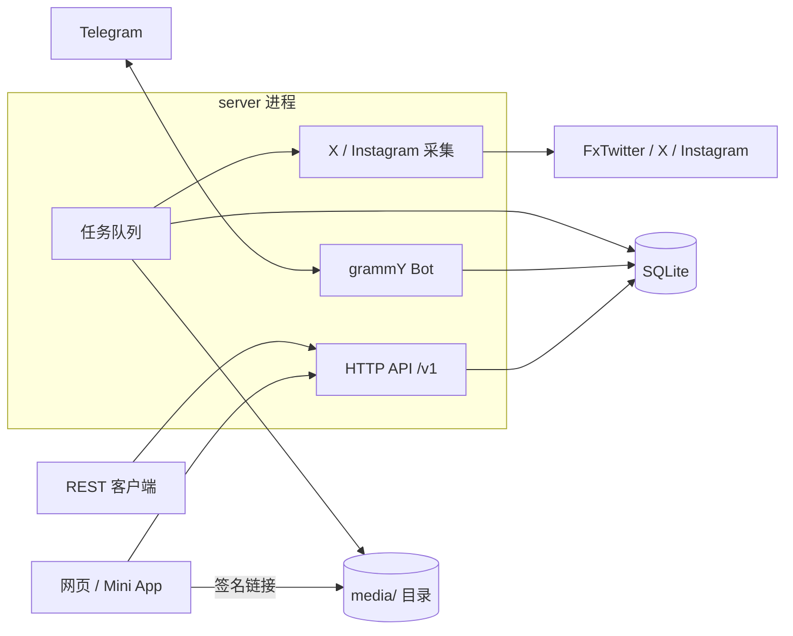

# 架构

Midden 是单用户、单进程的 TypeScript 应用。一个 Node.js 进程同时提供 HTTP API、网页、Telegram Bot、后台任务和采集。

## 代码结构

| 目录                    | 内容                                                                                                  |
| ----------------------- | ----------------------------------------------------------------------------------------------------- |
| `server/src/platforms/` | X 与 Instagram 采集，由旧版 adapter 移植，在进程内直接调用；`third_party/atmosphere` 是其依赖的上游库 |
| `server/src/capture/`   | 采集链路：提交、抓取、下载、缩略图、版本、related 展开与续页、关系网列表、记录与进度、批量刷新、维护  |
| `server/src/library/`   | 读取：收藏详情、筛选列表、作者、版本、删除、标签备注、收藏夹、公开分享、关注变化                      |
| `server/src/accounts/`  | 采集账号与加密凭据                                                                                    |
| `server/src/jobs/`      | 存在 SQLite 中的持久化任务队列                                                                        |
| `server/src/blob/`      | 媒体存储接口、本地目录实现、签名链接                                                                  |
| `server/src/http/`      | Hono 路由与认证                                                                                       |
| `server/src/telegram/`  | Bot：命令、消息渲染与分段、投递、媒体发送                                                             |
| `server/drizzle/`       | 由 drizzle-kit 生成的数据库迁移，启动时自动应用                                                       |
| `web/`                  | Vue 网页，构建后由 server 在 `/app/` 提供                                                             |

## 数据

- 一个平台对象（帖子、Profile）对应一条 `collections`；`library` 表示它在收藏库中。每次非刷新的提交都会保存目标，包括 Profile 时间线中的成员和被引用的帖子、账号。
- 新增与更新：提交时在 `submissions.library_added` 记下目标此前是否已在收藏库中且有内容（只有 `library` 行、因抓取失败没有内容的不算已收藏），身份规范化后改到已收藏的对象上时改记为更新。采集记录与 Telegram 进度按此对保存完成的帖子分别计数新增与更新，Profile 时间线中出现在多页的帖子算一次，任一页新增即为新增；有成员早于该列（值为空）时不显示这两项。采集记录详情按此把帖子分为新增记录、更新记录（只含保存完成的帖子）与异常记录（失败与不完整）三栏，有成员早于该列时改为全部与异常记录两栏；另有成员仍在采集时多出进行中一栏，完成后各自移到对应栏。
- 每次抓取是一条 `captures`。内容与最新版本不同时才产生新的 `revisions`；作者资料、计数（点赞数等）、实体编号的变化不算内容变化，平台在实体类型上声明为不稳定（`volatilePaths`，同样的请求时有时无、应用也不显示，如 X 简介的提及 facets 与 `about_account`）的字段也不算。计数随每次抓取保存在 `captures.metrics`。
- 收藏的历史以成功的抓取为点：看起来与前一次成功抓取不同的抓取才成为一个点，连续相同的抓取只保留第一次。比较的是版本中点所显示的部分（`revisions.view_hash`：不含 Profile 时间线记下的转发，它们只用于标记列表中的帖子，而自动刷新不读时间线）和根实体自己的计数（帖子作者、被引用帖子的计数不在这一页显示）。每个点显示它所对应版本的内容和这次抓取的计数，详情页的时间线在这些点之间移动。没有 `view_hash` 的版本按版本本身比较。
- 统计趋势不折叠：`GET /v1/collections/:id/counts` 列出每次成功抓取为根实体记下的计数（按指针，如 `/metadata/followers`），最旧的在前，最多最近 1000 次（`limit` 可取更少，详情页只取 2 次来判断是否有趋势）。至少两次抓取读到同一项计数时，详情页提供「统计趋势」页，每项计数一张折线图。
- 资料修改记录：`GET /v1/collections/:id/profile-changes` 按时间比较 Profile 相邻的版本，列出页面显示的资料（昵称、用户名、简介、受保护、头像、主页封面）有变化的版本，最新的在前，每条给出变化的字段及其前后的值。只比较网页显示的部分，读法与网页相同（简介没有 `description` 时取版本文本）；计数、不稳定字段、时间线记下的转发等不显示的部分不算。图片按内容哈希比较；抓取未能保存的图片、未说明是否受保护的抓取视为未知，不算变化。只比较最近 1000 个版本（`limit` 可取更少的条目）；不是 Profile 的收藏返回空列表。Profile 至少有一条记录时（详情页只取 1 条来判断），详情页提供「资料修改记录」页，按天分组的时间线，最新的在上。
- 实体（帖子、账号）按平台身份共享，`entity_versions` 按内容去重。
- 媒体按 SHA-256 存在 `media/ab/cd/<哈希>`，`blobs` 记录类型与大小，缩略图同样按内容存放。
- 删除收藏后，维护任务在没有进行中的抓取时删除其内容；不再被引用的媒体文件 24 小时后删除。
- `catalog` 为每个有版本的收藏保存列表筛选与排序所需的字段（根实体类型、作者、媒体种类、发布时间、占用空间、搜索文本等），由最新版本派生，在同一事务内随抓取完成和原始响应清理更新。列表只读这张窄表；作者的最新资料、作者被打的标签、被保存的转发等跨收藏的条件在查询时通过索引计算。启动时会补齐缺失的行，所以改变它的派生方式时，在迁移中清空这张表即可重建。

## 标签

- 标签是 `tags(id, name)`，名称唯一，收藏通过 `collection_tags` 关联。筛选和收藏夹按 id 引用标签（`tag=<id>`），所以改名只改 `tags.name`。名称去掉首尾空白后不能为空，最多 64 字，创建和改名用同一套校验。
- 列表按标签筛选：`tag=<id>,<id>` 要求带有其中任一标签，加 `tag_mode=all` 时要求全部带有；`not_tag=<id>,<id>` 排除带有其中任一标签的收藏。「带有」包括作者的已保存 Profile 带有这个标签（给账号打的标签覆盖它的帖子），排除也按同样的含义。同一个 id 不能既要求又排除，每个列表最多 100 个。标签集合由 `collection_tags` 的索引查出，6 万条收藏时计数在几十毫秒内。规范化时 id 去重排序，只有一个要求的标签或 `tag_mode=any` 时去掉 `tag_mode`，所以计数缓存和翻页位置不受 id 顺序影响。公开接口不接受也不显示标签条件。
- `PATCH /v1/tags/:id`（`name`）改名。已有别的标签叫这个名字时两者合并，在一个事务内：把收藏移到已有的标签（已同时带两个标签的收藏不重复），把收藏夹筛选的 `tag`、`not_tag` 中的旧 id 换成新 id，去重后重新规范化（合并后同一 id 既要求又排除时保留要求），删除旧标签。响应给出最终的标签、是否合并（`merged`）和新带上该标签的收藏数（`moved`）。按条件缓存的计数随这次写入失效。
- `DELETE /v1/tags/:id` 删除标签及其所有关联，并从收藏夹筛选的 `tag`、`not_tag` 中去掉它；列表空了就去掉这个参数（以及不再有意义的 `tag_mode`），收藏夹因此可能选中更多内容。
- 网页：筛选面板中标签是一排可点的标签，点一次要求，再点一次排除（显示为「非 X」），第三次取消，「全部」清空标签条件；要求两个以上标签时出现「任一 / 全部」。筛选摘要写成「甲、乙」「甲 且 乙」「非 丙」。「标签」旁有「编辑」，打开后点标签可改名或删除。新名称已被别的标签使用时先确认「已有标签「X」，将合并 N 条收藏」，删除也先确认；数量来自 `GET /v1/collections/count?tag=<id>`。之后标签列表、筛选摘要随之更新，当前筛选中被合并的标签换成合并后的 id，被删除的去掉；打开的收藏夹在本地按同样的规则改写，不会显示为已修改。

## 收藏夹

- 收藏夹是保存下来的列表筛选。`folders` 表只存名称和筛选条件，筛选条件就是收藏列表 `GET /v1/collections` 的查询字符串，不含翻页位置和网页的布局，按 `library/filter-query.ts` 规范化（只留筛选与排序参数，去掉空值，键按序，作者排序，标签 id 去重排序），所以新增筛选项不用改表。保存时与列表接口共用解析和校验，列表不接受的条件不能保存。
- 打开收藏夹就是用这组条件显示收藏列表，之后保存的内容符合条件即在其中。手动分组靠标签筛选；收藏夹筛选（要求或排除）的标签即使不再有收藏使用也会保留。
- 收藏夹的条件可以包含任意平台，也可以同时包含帖子和账号：`entity_type` 列出几种类型，或者不写（所有类型）。
- `GET /v1/folders` 给出每个收藏夹在其条件下的收藏数和按根实体类型分开的数量（`types`），与列表用同一套查询；任意条件的同样计数由 `GET /v1/collections/count?<筛选>` 给出。一次计数要读全库（6 万条时几十毫秒），所以计数按条件缓存（不含排序），数据库有写入（`total_changes()` 或 `data_version` 变化）后失效，相对收藏日期换了一天也重新计数；重新计数时每个收藏夹之间让出事件循环，不阻塞其他请求。
- 收藏日期可以是相对的：`saved_within=<n>d` 表示包括今天在内的最近 n 个自然日，每次请求按当时的时间重新计算起点，`time_zone`（IANA 时区，默认 UTC）决定「一天」从哪里开始；不能与 `saved_from` / `saved_before` 同时使用，没有 `saved_within` 时规范化会去掉 `time_zone`。绝对日期的条件照旧可用。
- 网页：首页类型标签下方一行列出所有收藏夹和数量，不分当前标签；有筛选时工具栏出现「存为收藏夹」，保存的条件带上当前标签的类型。收藏夹页的地址是 `#/folder/<id>?<筛选>`，筛选用地址栏的形式（本地日期），只有 id 的地址显示收藏夹保存的筛选；条件为空时写成 `entity_type=`，以免被当成只有 id 的地址。收藏夹中帖子和账号分开列出：条件涉及两种类型时，按计数判断结果里实际有几种，两种都有才显示「帖子 / 账号」标签，只有一种时直接列出。所在标签记在地址的 `tab` 中，和布局一样不属于筛选，切换不会让收藏夹显示为已修改。收藏夹的筛选面板多一项「类型」（全部 / 帖子 / 账号）。筛选改动后显示「筛选条件已修改」，可「更新收藏夹」或「另存为」；右上角菜单可重命名、删除。
- 快捷日期「今天」「最近 7 天」「最近 30 天」写成 `saved_within=1d` / `7d` / `30d`，网页附上浏览器的时区，与日期框按本地日期计算的含义一致；所以按快捷日期保存的收藏夹总是显示最近的那几天。自定义日期仍是固定日期。收藏夹的时区与浏览器相同时地址中省略。

## 公开分享

- 可以公开一个收藏夹、一个 Profile 或一个帖子。`shares` 表每行是一个公开链接：随机的 `slug`（18 字节随机数，base64url 共 24 个字符，144 位）、目标类型（`folder` 或 `collection`）、目标 id、创建时间和取消时间。同一目标同时只有一个有效链接，再次分享返回它；取消公开只记下取消时间，这一行永远不再有效，重新公开会得到新链接。删除收藏、清空收藏库或删除收藏夹时，同一事务内取消指向它们的链接，所以之后再次保存同一对象也不会让旧链接复活。
- 自定义链接：所有者可以把 `slug` 改成自己取的（`PATCH /v1/shares/:id`，`{slug}`；`null` 换回新的随机 `slug`），只能用小写字母、数字和 `-`，3 到 64 个字符，不能以 `-` 开头或结尾，否则 400。自定义的 `slug` 可以猜到，这是有意的。每个链接只有一个地址：改动后旧 `slug` 立即失效，没有别名或跳转。`slug` 只在有效链接之间唯一（`shares_slug_live`，只覆盖未取消的行的唯一索引），已被其他有效链接使用时返回 409；已取消或已改掉的 `slug` 可以再被使用，届时它指向新的链接，原来的链接仍是取消的。公开接口同样接受随机与自定义两种形式。
- 公开范围在每次请求时按当前数据计算（`library/share-scope.ts`），不冻结成员：
  - 帖子：只有它本身。
  - Profile：它本身，以及详情页下方列出的帖子，即 `related_to=<Profile>`、实体类型为同平台帖子的列表。
  - 收藏夹：收藏夹的筛选条件此刻选中的收藏（之后保存或打标签的内容符合条件即公开，不再符合即失效），加上其中每个 Profile 详情页列出的帖子。判断一个帖子是否属于某个 Profile 时，先按实体身份和别名找出可能列出它的 Profile，再用这个 Profile 的列表查询本身确认，所以结果与详情页一致。
- 公开接口在 `/v1/public/:slug/...`，不需要登录，只能读：分享本身（`GET /v1/public/:slug`：目标类型，收藏夹给出名称和帖子、账号各有多少条，不给出筛选条件）、收藏夹的列表、某个 Profile 的帖子列表（`?related_to=`，只限分享中显示的 Profile）、列表的作者（`/collections/authors`，同样可加 `related_to`）、收藏详情、历史点、统计趋势、资料修改记录、关系网计数与关注变化。每个请求先确认 `slug` 有效、目标仍在，再确认所请求的收藏在范围内；不在范围内与不存在、已取消、格式不对一样返回 404 `内容不存在或已删除`。历史点还要求抓取属于该收藏，所以不能借范围内的收藏读别的收藏的抓取。
- 公开列表接受私有列表的筛选与排序参数，只有 `tag` 不接受（会暴露所有者的标签名），带上即 400；其他未知参数同样拒绝。访客的筛选加在收藏夹自己的条件（或 Profile 的帖子列表）之上，只能缩小、不能扩大范围；`entity_type` 也是如此，帖子、账号两个标签就是按它分开的。排序由访客决定，不用收藏夹保存的排序，默认发帖时间从新到旧。作者列表只统计这份列表中的收藏，不列出范围外的作者，数量也只按范围内计算。
- 返回内容复用私有接口的读取，只在出口处删减：去掉保存时间、占用空间、实体与版本 id；只有指向范围内收藏的 `saved_collection_id` 保留，其他关联不可在公开页中跳转（网页退回到平台原链接）。引用或转发它的帖子只保留范围内的；范围外的账号只留名称和头像。关注变化中的账号都显示名称和头像，只有范围内的链接到它的收藏。帖子自身版本中的引用帖子和作者属于帖子内容，照常显示。标签、备注、采集记录与进度、账号与凭据、原始响应不在任何公开接口中，也没有写操作。媒体签名链接和头像、封面的平台原图地址（`remote_url`）只随这些删减后的内容给出。
- 公开接口的响应带 `X-Robots-Tag: noindex, nofollow` 和 `Referrer-Policy: no-referrer`；`/app/` 页面带同样的响应头和 `<meta name="robots">`。受保护账号照常显示，不另加提示。
- 网页：公开页与私有网页是同一个构建，地址为 `/app/#/s/<slug>`，其下的收藏详情、统计趋势、资料修改记录、关注变化为 `#/s/<slug>/collection/<id>[/stats|/changes|/follows]`。这些路由不检查登录，读取改走公开接口，指向收藏的链接留在分享内；收藏夹列表和 Profile 的帖子列表有与私有列表相同的筛选与排序，只是没有标签；作者选项读公开的作者列表。收藏夹列表的筛选、排序和所在标签写在地址的查询中（与首页一样，账号标签写成 `entity_type`），可以直接分享筛选后的页面；Profile 的帖子列表和私有页面一样不写入地址。页面上没有批量更新、重新抓取、我的整理、删除。敏感媒体默认遮住，访客可以点开或在右上角全部显示，不记住选择。公开页不加载 Telegram 的 Mini App 脚本，访客不会请求 telegram.org；私有网页在路由第一次读取地址之前动态加载它，因为它从地址中读取 Mini App 的启动数据（`tgWebAppData`）。
- 管理：`GET /v1/shares`（加 `collection=<id>` 时只列出使它公开的链接：它自己的、包含它的收藏夹、列出它的 Profile）、`POST /v1/shares`（`target`、`id`）、`DELETE /v1/shares/:id`。收藏夹右上角菜单与收藏详情页有「公开分享」，可创建链接、复制、取消公开；详情页这一行注明已公开，或已随哪个收藏夹、所在账号公开。

## 关系网

- 更新（重新抓取）X 账号主页时可勾选「抓关系网」（默认不勾），网页的收藏详情和采集选项里都有；接口是 `POST /v1/captures` 的 `options.relations`，与帖子选项放在同一个 `options` 里，以后的「抓帖子」等主页选项也放在这里。只对显式提交的 Profile 生效，其他目标忽略它。没有单独只抓关系网的入口。
- 每个列表（关注、粉丝）是一条 `relation_fetches`，随请求（`submissions`）创建，等这次主页抓取结束（`deliveries`）后开始。是否抓取按这次抓到的资料里该列表的人数单独判断：超过 5000 人的列表跳过（`skipped`），例如 2 万粉丝、300 关注时只抓关注；资料没有人数也跳过。列表要用采集账号读，用这次抓取的账号，否则用当前选中的账号，都没有则失败。
- 抓取是任务 `relations`（`capture` 队列，与同一账号的抓取一次一个）：每次运行最多读 5 页，每页在一个事务里保存，然后作为新任务继续，所以后面页面的限流不会用掉前面页面的重试次数；平台给出的 `retry-after`（X 的限流按 `x-rate-limit-reset` 换算）优先。进度显示在这次更新的采集记录中（详情页开始更新后由「查看进度」打开），记录在列表抓完前不算结束。
- 列表中的每个账号都成为收藏库中的 Profile（`library` 行，来源与这个主页相同，不另作标记）。还没有任何版本的，用列表里的资料生成第一个版本：一次已完成的抓取，头像、封面记为未下载（`failed`，说明「来自关注列表的资料，未下载图片」），所以以后真实抓取时它们算未知，不会出现假的资料修改；接口在这类没有下载的头像、主页封面上给出平台的原图地址（`remote_url`，只限 https），网页在收藏列表、详情、作者、关注变化和公开页中直接从平台显示（`referrerpolicy="no-referrer"`），本地保存的图片总是优先；已有版本的账号不动，列表数据不会给真实抓取过的资料添加版本。不为补全资料去请求这些账号。每页的实体、收藏、版本、`catalog` 都按批写入，语句数与页内账号数无关。
- 关注关系存为区间 `follow_edges(follower_id, followee_id, first_seen_at, last_seen_at, ended_at)`，按实体（`entities.id`）而不是收藏记录，任何人的列表中看到的都算：B 出现在 A 的粉丝列表里即 B 关注 A。每对账号最多一个未结束的区间（`follow_edges_open`）；结束后再次看到会新开一行。索引分别服务「X 关注谁」「谁关注 X」与互关。账号的收藏被删除后，有关注关系的实体保留。
- 完整性：只有**完整**的抓取才能结束关系。读到列表末尾、且列出的账号数不少于资料人数减去允许的缺口（10%，至少 5 个，被封禁、停用的账号计入人数但不会列出）时为 `complete`，此时这个列表里在本次开始前没再看到的关系结束（`ended_at`）：A 的完整关注列表里没有 B，A→B 结束；A 的完整粉丝列表里没有 B，B→A 结束。列不全（`partial`）或失败（`failed`）的抓取只记录看到的关系，从不结束任何关系。`relation_fetches` 中每个账号、每个列表最新的 `complete` 记录就是该视角最近一次完整的时间（`relation_fetches_complete`）。
- 关注变化：`GET /v1/collections/:id/follow-changes` 列出账号的新关注、取关、新粉丝、掉粉，最新的在前，最多 1000 条。开始的关系只有在该列表第一次完整抓取之后才算变化（之前的只是起点）；结束总是变化。时间是观察时间：变化发生在 `since`（上一次确认旧状态的抓取）与 `observed_at` 之间。`GET /v1/collections/:id/follows` 给出按已存关系计算的关注、粉丝、互关数，没有任何关系时返回空对象。
- 网页：有关系数据时详情页显示「关系网」关注 / 粉丝 / 互关数，有变化时提供「关注变化」页（`#/collection/<id>/follows`），与资料修改记录同样按天分组的时间线；没有数据时都不显示。

## 任务

任务保存在 `jobs` 表，按队列限制并发：`capture` 4、`download` 8（缩略图共用，优先级较低）、`control` 4。失败按 2、4、8… 秒退避，最多 3 次；平台给出的 `retry-after` 优先；无法通过重试解决的错误直接失败。进程重启时，运行中的任务回到队列。

抓取的状态在结果保存前一直是 `queued`，所以它本身分不出排队与正在抓取。采集记录、成员列表、`GET /v1/jobs/:id` 和 Telegram 按抓取任务在 `jobs` 中的状态区分：任务尚未运行时给出 `waiting`（`queue`：等待空闲的并发位置或账号；`retry`：失败后等待重试），网页显示「排队中」「等待重试」，否则显示「正在采集」。

## 媒体链接

API 返回的媒体带有限时签名链接（`/media/<哈希>?e=…&t=…&s=…`），浏览器直接请求，不依赖登录 Cookie。链接在 12 小时的时间窗内保持不变，便于浏览器缓存。`BlobStore` 是可替换的接口，将来可以加入 S3 等远端实现，届时由它返回远端的预签名链接。

## 认证

- 网页：Telegram 登录组件或 Mini App 的 initData，验签后只接受 `OWNER_TELEGRAM_ID`；会话 Cookie `__Host-midden` 有效 12 小时，写请求校验 Origin。
- REST：Bearer token，数据库只存哈希。

## Telegram Bot

长轮询，只处理所有者的消息与按钮。每个需要发送的结果（抓取状态与结果、`/show`、Profile 进度）是一条 `telegram_deliveries`，按段发送并记录进度，重启后从中断处继续。上传过的媒体按 Bot 记录 `file_id`，再次发送时直接复用。
