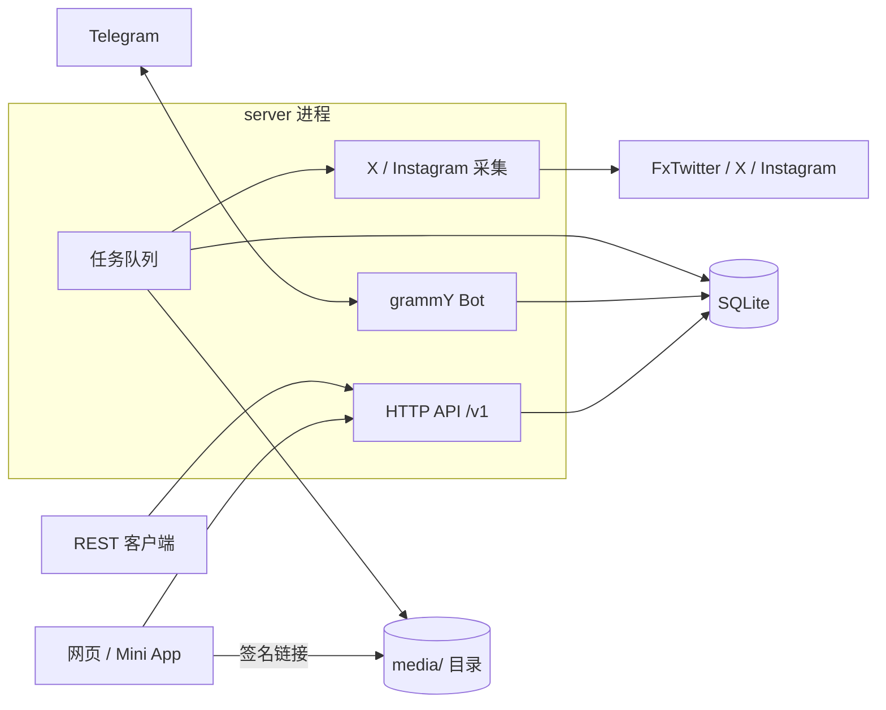

# 架构

Midden 是单用户、单进程的 TypeScript 应用。一个 Node.js 进程同时提供 HTTP API、网页、Telegram Bot、后台任务和采集。

## 代码结构

| 目录                    | 内容                                                                                                  |
| ----------------------- | ----------------------------------------------------------------------------------------------------- |
| `server/src/platforms/` | X 与 Instagram 采集，由旧版 adapter 移植，在进程内直接调用；`third_party/atmosphere` 是其依赖的上游库 |
| `server/src/capture/`   | 采集链路：提交、抓取、下载、缩略图、版本、related 展开与续页、记录与进度、批量刷新、维护              |
| `server/src/library/`   | 读取：收藏详情、筛选列表、作者、版本、原始响应、删除、标签备注                                        |
| `server/src/accounts/`  | 采集账号与加密凭据                                                                                    |
| `server/src/jobs/`      | 存在 SQLite 中的持久化任务队列                                                                        |
| `server/src/blob/`      | 媒体存储接口、本地目录实现、签名链接                                                                  |
| `server/src/http/`      | Hono 路由与认证                                                                                       |
| `server/src/telegram/`  | Bot：命令、消息渲染与分段、投递、媒体发送                                                             |
| `server/drizzle/`       | 由 drizzle-kit 生成的数据库迁移，启动时自动应用                                                       |
| `web/`                  | Vue 网页，构建后由 server 在 `/app/` 提供                                                             |

## 数据

- 一个平台对象（帖子、Profile）对应一条 `collections`；`library` 表示它在收藏库中。每次非刷新的提交都会保存目标，包括 Profile 时间线中的成员和被引用的帖子、账号。
- 每次抓取是一条 `captures`。内容与最新版本不同时才产生新的 `revisions`；作者资料、计数（点赞数等）、实体编号的变化不算内容变化。计数随每次抓取保存在 `captures.metrics`。
- 实体（帖子、账号）按平台身份共享，`entity_versions` 按内容去重。
- 媒体按 SHA-256 存在 `media/ab/cd/<哈希>`，`blobs` 记录类型与大小，缩略图同样按内容存放。
- 删除收藏后，维护任务在没有进行中的抓取时删除其内容；不再被引用的媒体文件 24 小时后删除。
- `catalog` 为每个有版本的收藏保存列表筛选与排序所需的字段（根实体类型、作者、媒体种类、发布时间、占用空间、搜索文本等），由最新版本派生，在同一事务内随抓取完成和原始响应清理更新。列表只读这张窄表；作者的最新资料、作者被打的标签、被保存的转发等跨收藏的条件在查询时通过索引计算。启动时会补齐缺失的行，所以改变它的派生方式时，在迁移中清空这张表即可重建。

## 任务

任务保存在 `jobs` 表，按队列限制并发：`capture` 4、`download` 8（缩略图共用，优先级较低）、`control` 4。失败按 2、4、8… 秒退避，最多 3 次；平台给出的 `retry-after` 优先；无法通过重试解决的错误直接失败。进程重启时，运行中的任务回到队列。

## 媒体链接

API 返回的媒体带有限时签名链接（`/media/<哈希>?e=…&t=…&s=…`），浏览器直接请求，不依赖登录 Cookie。链接在 12 小时的时间窗内保持不变，便于浏览器缓存。`BlobStore` 是可替换的接口，将来可以加入 S3 等远端实现，届时由它返回远端的预签名链接。

## 认证

- 网页：Telegram 登录组件或 Mini App 的 initData，验签后只接受 `OWNER_TELEGRAM_ID`；会话 Cookie `__Host-midden` 有效 12 小时，写请求校验 Origin。
- REST：Bearer token，数据库只存哈希。

## Telegram Bot

长轮询，只处理所有者的消息与按钮。每个需要发送的结果（抓取状态与结果、`/show`、Profile 进度、批量更新进度）是一条 `telegram_deliveries`，按段发送并记录进度，重启后从中断处继续。上传过的媒体按 Bot 记录 `file_id`，再次发送时直接复用。
