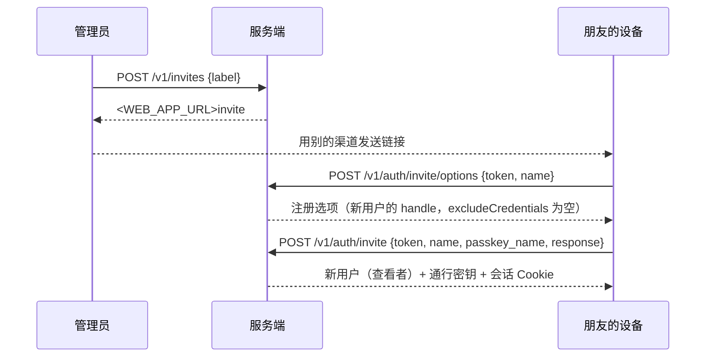

# 多用户（设计）

设计稿。A 的服务端已实现（第 9.1 节的五个服务端提交），网页还没有：现有行为见[架构](../architecture.md)与[运维](../operations.md)，这里写要变的部分。先做 A：只读的查看者；目标是 B：每个用户有自己的存档，内容共用一个去重的池。

所有者已经回答了 A 的问题（第 11.2 节），本文按回答写。B 的问题仍待定。

两项正在进行的工作会影响本文，相关处分别标注：

- **P3.4**：收藏夹改存查询，不再存 `CollectionFilter` 的查询字符串；
- **桌面界面**（`desktop-round4`）：历史页的「资料 / 数据 / 关注」三个标签、卡片的「⋯」菜单、侧栏中进行中的更新与 `GET /v1/collections/aggregate`。

## 1. 目标与非目标

A（现在）：

- 两种角色：管理员与查看者。管理员只有一个，就是现在的所有者。查看者对内容完全只读，能改的只有自己的通行密钥、登录设备和令牌。
- 邀请：管理员生成一次性链接，7 天有效，只能注册一次。朋友在自己的设备上创建通行密钥，成为查看者。
- 多用户只用一个域名：`WEB_APP_URL` 的域名。管理员的其他域名照旧只属于管理员。
- 通行密钥、已登录的设备（现有的滑动会话）和 API 令牌都按用户分开，各人只看到自己的。查看者只能建只读令牌，只能用于 Agent API，能看到的范围与网页上相同，并发与管理员分开。
- 管理员有「用户」页：用户列表、撤销、删除、邀请。
- 权限在服务端强制执行。路由默认对查看者关闭，由路由扫描测试和泄漏测试守住。
- 数据模型新增 `users` 与 `invites`，会话、通行密钥、令牌加上 `user_id`。收藏库、标签、收藏夹不改。

B（以后，见第 10 节）：收藏库的成员、标签、收藏夹（以后还有备注）都按用户分开，各人用自己的采集账号。采集到的内容进入一个共享、去重的池：帖子、Profile、版本、媒体、原始响应。

A 不做：

- 查看者的任何写入：标签、备注、采集、更新、删除、分享、收藏夹、定期更新。
- 改角色、多个管理员。
- 多个域名上的多用户，以及给已有用户的登录链接（换设备、换域名、撤销后恢复）。
- 用户的最近活动（访问记录），以及注册和查看者通行密钥变动时给管理员的通知。
- 存储额度，以及按用户计算的用量。
- 多用户的 Telegram Bot。Mini App 只给管理员。
- 登录用户之间的可见性隔离：所有人看到同样的内容，包括采集账号读到的受保护账号的内容（第 11 节风险 1）。
- 公开分享页的任何变化。
- 自助注册、密码、邮件、OAuth：没有邀请就不能注册。

以后再做的（都不影响 A 的数据模型）：多个域名与登录链接（第 4.5 节）、改角色与多个管理员（第 10.8 节）、最近活动（第 3.1 节）与通知（第 10.6 节）。

## 2. 角色与权限

### 2.1 主体

登录检查之后，每个请求有一个主体（`Principal`）：

- `userId`；`role`（`admin` 或 `viewer`）。
- `via`：`session`（网页会话）或 `token`（API 令牌）。令牌另带它的 `permission`。

有效权限：查看者无论用会话还是令牌都只读，令牌上写的 `rw` 不起作用；管理员的会话可以读写，令牌按 `ro` / `rw`。

管理员是迁移时由现在的所有者变成的 1 号用户，A 中只有这一个。`OWNER_TELEGRAM_ID` 对应他，Bot 和 Mini App 只属于他。他不能被撤销或删除。

### 2.2 守卫

| 守卫                  | 规则                                                                                                         | 来自                                      |
| --------------------- | ------------------------------------------------------------------------------------------------------------ | ----------------------------------------- |
| 默认                  | 查看者 403；管理员按令牌权限                                                                                 | 新增                                      |
| `viewers`（路由标记） | 查看者也可以调用。写法与 `inline`、`readOnly` 相同（`.get('/collections', viewers, …)`），由 `routeHas` 判断 | 新增                                      |
| `adminSession`        | 管理员的网页会话；任何令牌都不行                                                                             | `ownerOnly`（删除类）                     |
| `sessionOnly`         | 任何用户的网页会话，只作用于自己的行                                                                         | `ownerOnly`（令牌、会话、通行密钥的管理） |
| 只读令牌              | `GET`、`HEAD` 和 `readOnly` 以外答 403                                                                       | 不变                                      |
| 查看者的令牌          | 只在 `/agent/v1` 有效，在 `/v1` 上答 403                                                                     | 新增                                      |

`viewers` 是白名单。新加的路由忘了归类时，查看者得到 403，不会泄漏。哪些路由带这个标记，由测试里的一张表固定（第 8 节）。拒绝发生在 `offload` 之前，被拒绝的请求不占读取线程。

### 2.3 `/v1`

查看者在 `/v1` 上只用网页会话；他的令牌在这里答 403（第 7.1 节）。

记号：

- **允许**：两种角色都可以，回答相同。
- **管理员**：只有管理员，会话或令牌都可以，令牌按其权限。
- **管理员会话**：只有管理员的网页会话。
- **自己的**：任何用户的网页会话，只看到、只改动自己的行。
- **过滤 ★**：查看者可以调用，回答按第 5 节过滤。
- **拒绝**：查看者得到 403。

登录（不需要登录）：

| 接口                                                                       | 管理员 | 查看者 | 说明                                                               |
| -------------------------------------------------------------------------- | ------ | ------ | ------------------------------------------------------------------ |
| `POST /v1/auth/passkey/options`、`POST /v1/auth/passkey`                   | 允许   | 允许   | 登录，会话属于这个通行密钥的用户                                   |
| `POST /v1/auth/passkey/register/options`、`POST /v1/auth/passkey/register` | 凭链接 | —      | Bot 的 `/passkey` 链接，给管理员添加通行密钥，不变                 |
| 新：`POST /v1/auth/invite/options`、`POST /v1/auth/invite`                 | —      | 凭邀请 | 凭邀请注册成为查看者（第 4.1 节），只在 `WEB_APP_URL` 的来源上可用 |
| `POST /v1/auth/telegram`                                                   | 允许   | 拒绝   | Mini App 只给管理员（现在就是这样）                                |

会话与实例：

| 接口                                                                                                       | 管理员 | 查看者 | 说明                                                       |
| ---------------------------------------------------------------------------------------------------------- | ------ | ------ | ---------------------------------------------------------- |
| `GET /v1/session`                                                                                          | 允许   | 过滤 ★ | 回答自己的用户（`id`、`name`、`role`）和 `can`，不再是 204 |
| `DELETE /v1/session`                                                                                       | 允许   | 允许   | 退出当前会话                                               |
| `GET /v1/instance`、`PUT /v1/instance/litestream`                                                          | 管理员 | 拒绝   |                                                            |
| `GET /v1/storage`、`POST /v1/storage/composition`、`PUT /v1/storage/alerts`                                | 管理员 | 拒绝   | 管理员面板的「存储用量」                                   |
| `GET /v1/queue`、`GET /v1/queue/slow-queries`、`PUT /v1/queue/control`、`POST /v1/queue/rate-limits/clear` | 管理员 | 拒绝   |                                                            |

收藏库的读取：

| 接口                                                                                                                      | 管理员 | 查看者 | 说明                                                                                 |
| ------------------------------------------------------------------------------------------------------------------------- | ------ | ------ | ------------------------------------------------------------------------------------ |
| `GET /v1/collections`                                                                                                     | 允许   | 过滤 ★ | `tag`、`tag_mode`、`not_tag` 答 400；新参数 `folder=`（第 5.4 节）只认公开中的收藏夹 |
| `GET /v1/collections/count`                                                                                               | 允许   | 过滤 ★ | 参数的处理同上                                                                       |
| `GET /v1/collections/aggregate`（桌面界面）                                                                               | 允许   | 过滤 ★ | 同上，另外 `by=tag` 答 400                                                           |
| `GET /v1/collections/authors`                                                                                             | 允许   | 允许   |                                                                                      |
| `GET /v1/query/suggest`（查询框的补全，本文写成后新加）                                                                   | 允许   | 过滤 ★ | `kind=tag` 为空，`kind=folder` 只有公开中的收藏夹                                    |
| `GET /v1/collections/perspectives`                                                                                        | 允许   | 过滤 ★ | 不标 `own`，采集账号也不排在最前                                                     |
| `GET /v1/collections/compare`、`GET /v1/collections/graph`、`GET /v1/collections/:id/graph`                               | 允许   | 允许   | `viewer` 参数照常；网页对查看者不默认标记任何账号                                    |
| `GET /v1/collections/:id`                                                                                                 | 允许   | 允许   | 包括占用空间与保存时间                                                               |
| `GET /v1/collections/:id/history`、`…/history/:capture`、`…/counts`、`…/profile-changes`、`…/follows`、`…/follow-changes` | 允许   | 允许   | 历史的「资料 / 数据 / 关注」、原站状态                                               |
| `GET /v1/entities/:id`                                                                                                    | 允许   | 允许   |                                                                                      |
| `GET /v1/usage`                                                                                                           | 允许   | 允许   | 收藏库的已用空间                                                                     |

收藏夹、标签与备注：

| 接口                                                                         | 管理员     | 查看者 | 说明                                                             |
| ---------------------------------------------------------------------------- | ---------- | ------ | ---------------------------------------------------------------- |
| `GET /v1/folders`                                                            | 允许       | 过滤 ★ | 只列公开中的收藏夹（有未取消的 `shares` 行），不给筛选条件或查询 |
| `POST /v1/folders`、`PATCH /v1/folders/:id`                                  | 管理员     | 拒绝   |                                                                  |
| `DELETE /v1/folders/:id`                                                     | 管理员会话 | 拒绝   |                                                                  |
| `GET /v1/tags`、`PATCH /v1/tags/:id`                                         | 管理员     | 拒绝   |                                                                  |
| `DELETE /v1/tags/:id`                                                        | 管理员会话 | 拒绝   |                                                                  |
| `GET /v1/collections/:id/annotation`、`PATCH /v1/collections/:id/annotation` | 管理员     | 拒绝   | 我的整理                                                         |

采集、更新与采集账号：

| 接口                                                                                                                            | 管理员                   | 查看者 | 说明                 |
| ------------------------------------------------------------------------------------------------------------------------------- | ------------------------ | ------ | -------------------- |
| `POST /v1/captures`、`GET /v1/captures`、`GET /v1/captures/:id`、`GET /v1/captures/:id/members`                                 | 管理员                   | 拒绝   | 采集记录             |
| `POST /v1/captures/:id/retry`、`…/retry-failed`、`…/pages`、`…/stop`                                                            | 管理员                   | 拒绝   |                      |
| `POST /v1/updates`、`POST /v1/updates/preview`、`POST /v1/updates/:id/pause`、`…/resume`、`…/continue`                          | 管理员                   | 拒绝   |                      |
| `GET /v1/jobs/:id`                                                                                                              | 管理员                   | 拒绝   |                      |
| `GET /v1/collections/:id/update`、`GET /v1/collections/:id/availability`                                                        | 管理员                   | 拒绝   | 详情页的「更新」一组 |
| `GET /v1/library`                                                                                                               | 管理员                   | 拒绝   |                      |
| `POST /v1/library/delete-all`                                                                                                   | 管理员会话（仅开发模式） | 拒绝   |                      |
| `GET /v1/accounts`、`POST /v1/accounts`、`PUT /v1/accounts/selection`、`POST /v1/accounts/:id/check`、`DELETE /v1/accounts/:id` | 管理员                   | 拒绝   | 采集账号             |
| `GET /v1/watches`、`PUT /v1/watches`、`PATCH /v1/watches/:id`                                                                   | 管理员                   | 拒绝   | 定期更新             |
| `DELETE /v1/watches/:id`                                                                                                        | 管理员会话               | 拒绝   |                      |
| `GET /v1/shares`、`POST /v1/shares`、`PATCH /v1/shares/:id`、`DELETE /v1/shares/:id`                                            | 管理员                   | 拒绝   | 分享只归管理员       |

删除：

| 接口                                                                                                                                                            | 管理员     | 查看者 |
| --------------------------------------------------------------------------------------------------------------------------------------------------------------- | ---------- | ------ |
| `DELETE /v1/collections/:id`、`POST /v1/collections/delete`                                                                                                     | 管理员会话 | 拒绝   |
| `POST /v1/collections/delete/preview`                                                                                                                           | 管理员     | 拒绝   |
| `POST /v1/media-removals`、`POST /v1/collections/:id/video-removal`                                                                                             | 管理员会话 | 拒绝   |
| `POST /v1/media-removals/preview`、`POST /v1/media-removals/restore`、`POST /v1/collections/:id/video-removal/preview`、`GET /v1/collections/:id/video-removal` | 管理员     | 拒绝   |

自己的凭据：

| 接口                                                                                                                                         | 管理员 | 查看者              | 说明                                                   |
| -------------------------------------------------------------------------------------------------------------------------------------------- | ------ | ------------------- | ------------------------------------------------------ |
| `GET /v1/passkeys`、`POST /v1/passkeys/options`、`POST /v1/passkeys`、`PATCH /v1/passkeys/:id`、`DELETE /v1/passkeys/:id`                    | 自己的 | 自己的              | 令牌曾能调用其中几个，已另行修复为只接受会话（风险 7） |
| `GET /v1/sessions`、`POST /v1/sessions/revoke-others`、`DELETE /v1/sessions/:id`                                                             | 自己的 | 自己的              | 别人的 id 答 404                                       |
| `GET /v1/tokens`、`POST /v1/tokens`、`PATCH /v1/tokens/:id`、`POST /v1/tokens/:id/roll`、`GET /v1/tokens/:id/usage`、`DELETE /v1/tokens/:id` | 自己的 | 自己的，只能建 `ro` | 别人的 id 答 404                                       |

管理：

| 接口                                                                                            | 管理员     | 查看者 | 说明                     |
| ----------------------------------------------------------------------------------------------- | ---------- | ------ | ------------------------ |
| `GET /v1/origins`                                                                               | 管理员     | 拒绝   |                          |
| `POST /v1/origins`、`DELETE /v1/origins/:id`                                                    | 管理员会话 | 拒绝   | 添加域名同属凭据（#163） |
| 新：`GET /v1/users`、`PATCH /v1/users/:id`、`POST /v1/users/:id/revoke`、`DELETE /v1/users/:id` | 管理员会话 | 拒绝   | 第 4.3 节                |
| 新：`GET /v1/invites`、`POST /v1/invites`、`DELETE /v1/invites/:id`                             | 管理员会话 | 拒绝   | 第 4.1 节                |

用户和邀请的管理与令牌、会话的管理一样，只属于网页会话：令牌不能生成能注册的链接。

### 2.4 `/agent/v1`

Agent API 只接受令牌。查看者的令牌只读，写入本来就是 403；读取另外由 `viewers` 标记决定。

| 接口                                                                                                                     | 管理员 | 查看者 | 说明                                                                                                 |
| ------------------------------------------------------------------------------------------------------------------------ | ------ | ------ | ---------------------------------------------------------------------------------------------------- |
| `GET /whoami`                                                                                                            | 允许   | 过滤 ★ | 多出 `user`（`id`、`name`、`role`）；`limits` 给出自己所在通道的上限                                 |
| `GET /posts`、`GET /accounts`                                                                                            | 允许   | 过滤 ★ | `tag`、`not_tag`、`tag_mode`、`q` 中的 `tag:` 答 400；条目没有 `tags`、`note`；`folder` 只认公开中的 |
| `GET /posts/:id`、`GET /accounts/:id`、`POST /posts/batch`、`POST /accounts/batch`                                       | 允许   | 过滤 ★ | 条目没有 `tags`、`note`                                                                              |
| `GET /posts/:id/context`、`GET /accounts/:id/relations`                                                                  | 允许   | 过滤 ★ | 同上（回答中含条目）                                                                                 |
| `GET /posts/:id/metrics`、`GET /accounts/:id/metrics`、`GET /accounts/:id/history`、`GET /accounts/:id/relation-changes` | 允许   | 允许   |                                                                                                      |
| `GET /aggregate`                                                                                                         | 允许   | 过滤 ★ | `by=tag` 答 400；`q` 的处理同搜索                                                                    |
| `GET /folders`                                                                                                           | 允许   | 过滤 ★ | 只列公开中的收藏夹，不给 `filter`                                                                    |
| `GET /tags`、`GET /updates/:id`、`GET /jobs`、`GET /watches`、`GET /shares`、`GET /capture-accounts`                     | 允许   | 拒绝   |                                                                                                      |
| 全部 22 个写入（`docs/agent.md` 第 8 节）                                                                                | `rw`   | 拒绝   |                                                                                                      |

### 2.5 公开接口与其他

| 地址                                      | 谁可以访问               | 说明                     |
| ----------------------------------------- | ------------------------ | ------------------------ |
| `/v1/public/:slug/…`（12 个 `GET`）       | 任何人，包括未登录的访客 | 不变，不看登录           |
| `GET /media/:key`                         | 持有签名链接的人         | 链接不绑定用户（风险 2） |
| `GET /agent.md`、`GET /healthz`、`/app/*` | 任何人                   | 不变                     |
| 8081 端口的 Litestream 心跳               | 只在容器之间             | 不变                     |

### 2.6 Telegram

| 功能           | 管理员 | 其他人 | 说明                                                                           |
| -------------- | ------ | ------ | ------------------------------------------------------------------------------ |
| 全部命令与按钮 | 允许   | 忽略   | `fromOwner` 不变：别人发来的消息照旧不回答                                     |
| `/passkey`     | 允许   | —      | 不变：为管理员生成各域名的 `/passkey` 链接                                     |
| Mini App 登录  | 允许   | 403    |                                                                                |
| Bot 的通知     | 收到   | —      | 只有现有的通知，包括管理员自己的通行密钥增删；查看者注册、增删通行密钥都不通知 |

## 3. 数据模型与迁移（A）

### 3.1 `users`

| 列            | 说明                                                                                                    |
| ------------- | ------------------------------------------------------------------------------------------------------- |
| `id`          | text 主键（UUIDv7）                                                                                     |
| `name`        | 显示名，1 到 32 字。注册时本人填写，默认是邀请的备注；管理员可以改                                      |
| `role`        | `admin` 或 `viewer`。部分唯一索引 `users_admin`（`WHERE role = 'admin'`）保证 A 中只有一个管理员        |
| `webauthn_id` | WebAuthn 的 user handle（base64url，唯一）。管理员沿用现在写死的 `midden-owner`，新用户用 32 字节随机数 |
| `created_at`  |                                                                                                         |
| `revoked_at`  | 撤销时间。非空时不能登录：凭据在撤销时已全部删除，这一列是第二道保险，也用来显示「已撤销」              |

A 不记录用户的最近活动，也没有别的访问记录。以后要有时，加 `last_seen_at`，在登录、会话续期（每天最多一次）和令牌用量写入（每分钟一次）这些本来就有的写入里顺带更新，精确到天。

每个用户的 user handle 都不同。原因是认证器按（RP ID、user handle）只保留一个通行密钥：如果所有人都用 `midden-owner`，在与管理员同步的设备上（iCloud 钥匙串、Google 密码管理器）注册第二个用户，就会覆盖管理员的通行密钥。管理员在第二个浏览器上邀请自己来测试（第 9.4 节）正是这种情况。

同样的原因，注册选项的 `excludeCredentials` 只列这个用户自己在该 RP ID 上的通行密钥。现在列的是该 RP ID 上的全部，持有管理员通行密钥的认证器会因此拒绝为测试用户注册。

### 3.2 `invites`

| 列                         | 说明                                                                                      |
| -------------------------- | ----------------------------------------------------------------------------------------- |
| `id`                       | text 主键，界面和 API 用它称呼一行                                                        |
| `digest`                   | 令牌的 SHA-256，唯一。令牌本身不存                                                        |
| `webauthn_id`              | 邀请在创建时就生成新用户的 user handle。注册的响应不带 handle，选项与注册两步必须用同一个 |
| `label`                    | 备注（给谁的），只给管理员看                                                              |
| `created_at`、`expires_at` | 7 天                                                                                      |
| `used_at`、`used_by`       | 注册成功时在同一个事务里写下，之后不能再用；`used_by` 为 `ON DELETE SET NULL`             |
| `revoked_at`               | 管理员撤销时写下                                                                          |

邀请总是新建查看者，也只在 `WEB_APP_URL` 的来源上可用，所以不记角色和来源。worker 在清理过期 `/passkey` 链接的同一个定时任务里，删除 7 天前就已过期、已用或已撤销的邀请。

`passkey_tokens`（Bot 的 `/passkey` 链接）不变：它们总是给管理员添加通行密钥，所以不需要 `user_id`。「再次发送 `/passkey` 时之前的链接作废」现在清空的是整张 `passkey_tokens`，与邀请无关。

### 3.3 外键

- `web_sessions.user_id`、`passkeys.user_id`、`api_tokens.user_id`：NOT NULL，`REFERENCES users(id) ON DELETE CASCADE`，各建一个 `(user_id)` 索引。删除用户时它们随之删除。
- `passkeys.credential_id` 仍然全局唯一。`api_token_usage` 经令牌 id 关联，随令牌级联删除。
- 收藏库、标签、收藏夹、分享、定期更新、采集账号、记录、任务都不加 `user_id`：A 中它们只属于管理员一侧，查看者根本碰不到。

### 3.4 迁移 `users`

一个迁移，一个事务：

1. 建 `users`，插入管理员：
   - `id` 在 SQL 中随机生成（做法与 `web_session_devices` 相同）；
   - `name` 为「管理员」，即 `RailUser` 现在写死的名字；
   - `role` 为 `admin`；
   - `webauthn_id` 为 `bWlkZGVuLW93bmVy`，即 `midden-owner` 的 base64url，所以已有的通行密钥不受影响；
   - `created_at` 取已有通行密钥、会话、令牌中最早的创建时间，都没有时取现在。
2. 按 `web_session_devices` 的办法重建 `web_sessions`、`passkeys`、`api_tokens`（`PRAGMA foreign_keys=OFF`，建 `__new_` 表，复制，改名），`user_id` 都填管理员。这几张表只有几十行，重建不到一毫秒。
3. 建 `invites`。

迁移之后：

- 已有的会话照常有效：摘要不变。
- 已有的通行密钥照常登录：user handle 不变。
- 已有的令牌照常可用，包括开发服务器的 `.local/dev-token`。
- 未用的 `/passkey` 链接照常可用。

它们都归管理员。`OWNER_TELEGRAM_ID` 仍只在 `.env` 中，不写进数据库：Bot 和 Mini App 认的是 `role = 'admin'` 的那一行。A 不需要 `users.telegram_id`，等 Bot 支持多用户时再加（第 10.6 节）。

### 3.5 从 `ownerOnly` 到角色

| 现在                                                                                       | A                                                     |
| ------------------------------------------------------------------------------------------ | ----------------------------------------------------- |
| `Env.session: boolean`：所有者的会话，或开发模式下的 `rw` 令牌                             | `Env.principal`（第 2.1 节），由 `via` 区分会话与令牌 |
| 删除收藏、媒体、所有视频、标签、收藏夹、定期更新、域名，开发模式的删除全部上的 `ownerOnly` | `adminSession`                                        |
| `/tokens`、`/sessions`、删除通行密钥上的 `ownerOnly`                                       | `sessionOnly`，并且只作用于自己的行                   |
| 没有守卫、`rw` 令牌可以做的写入                                                            | 只有管理员（查看者被默认规则挡住）                    |
| 开发模式下 `rw` 令牌等同会话                                                               | 只对管理员的 `rw` 令牌                                |
| Telegram 的 `fromOwner`、`OWNER_TELEGRAM_ID`                                               | 不变，对应管理员那一行                                |
| 架构文档「认证」中的「以后有多用户时，这些只给管理员」                                     | 就是 `adminSession`                                   |

## 4. 认证流程

沿用现有的机制：

- 令牌是 256 位随机数，放在地址的片段中（不发给服务器，不进日志），数据库只存它的 SHA-256；
- 挑战不入库，由 HMAC 绑定用途、来源和链接或调用者，5 分钟过期，只能用一次（`Challenges`）；
- 要求用户验证，检查计数器；
- 写入请求的 Origin 必须在来源列表中。

### 4.1 邀请

1. 管理员在「用户」页点「邀请」，填备注（1 到 32 字，也是新用户默认的名字）。`POST /v1/invites` 生成令牌，回答一次链接：`WEB_APP_URL` 下的 `invite` 页，由 `WEB_APP_URL` 拼出，不写死路径。链接只显示这一次，与 API 令牌一样。
2. 朋友打开 `invite#<令牌>`。页面不需要登录，填名字和通行密钥名称（默认是设备与浏览器）。取选项时带上名字（`name`，不带时用邀请的备注），注册时名字是 `name`，通行密钥名称是 `passkey_name`。
3. 取选项时，服务端确认两件事：Origin 是 `WEB_APP_URL` 的来源；邀请未用、未撤销、未过期。选项中：
   - `user.id` 是邀请上的 `webauthn_id`；
   - `userName` 是填写的名字，同一台设备的账号选择器因此分得清；
   - `excludeCredentials` 为空；
   - 挑战绑定 `register`、来源和 `invite:<摘要>`，所以一个邀请的挑战不能用于别的邀请或 `/passkey` 链接。
4. 注册时先验证 WebAuthn 响应，再在一个写事务中：
   - 把邀请标为已用：`UPDATE … SET used_at, used_by WHERE digest = ? AND used_at IS NULL AND revoked_at IS NULL AND expires_at > ? RETURNING`。没有行就答 403。两个人同时用同一个链接时只有一个成功；
   - 新建查看者，handle 取邀请上的；
   - 存通行密钥；
   - 建会话（`method = 'passkey'`）。

   回答之后网页进入收藏库。不给管理员发通知。

过期、已用、已撤销、来源不对，一律答 403「邀请链接已失效」，不区分原因。

### 4.2 登录与添加通行密钥

登录不变：可发现凭据，不需要用户名。按凭据 id 找到通行密钥，再找到它的用户，确认 `revoked_at` 为空，然后签发会话。登录选项不列凭据，所以账号选择器会列出设备上这个域名的全部通行密钥。管理员在同一个钥匙串里测试时会看到两个，各写着用户名。

已登录后添加通行密钥（`/v1/passkeys/options` 与 `POST /v1/passkeys`）也不变，只是用的是自己的 handle 和自己的 `excludeCredentials`。挑战仍绑定 Cookie 的哈希。查看者因此可以在同一个域名上给别的设备加通行密钥，前提是在那台设备上能用已有的通行密钥（同步的钥匙串，或扫码的跨设备登录）。

查看者丢了所有通行密钥，就只能删除或撤销后重新邀请，成为一个新用户。A 中这样就够了：查看者除了凭据没有别的数据。

### 4.3 撤销、删除、改名

都只能由管理员的会话发起，都不能作用于管理员自己。

撤销：`POST /v1/users/:id/revoke`。一个事务内删除这个用户的通行密钥、会话和令牌（令牌的用量随之级联删除），写下 `revoked_at`。用户行保留，「用户」页显示「已撤销」。A 中没有恢复：要再用，就重新邀请。

删除：`DELETE /v1/users/:id`。删除用户行，会话、通行密钥、令牌随外键级联删除，他用过的邀请的 `used_by` 变为空。A 中查看者没有别的数据，所以删除只是这些。已撤销的用户也可以删除。

两者生效的时刻相同。从下一个请求起：

- Cookie 找不到会话，答 401；
- 令牌答 401 `token_invalid`；
- 读取线程上已经开始的读取照常读完。线程不检查登录，下一个请求由网页进程检查。

已经发出的媒体链接仍有效，直到过期（风险 2）。

改名：`PATCH /v1/users/:id`（`{name}`）。A 中不能改角色。

### 4.4 Mini App

`POST /v1/auth/telegram` 验签后仍只接受 `OWNER_TELEGRAM_ID`，会话属于管理员。查看者即使找到 Bot 的 Mini App 按钮也只会得到 403，而且 Bot 本来就不回答他们。

### 4.5 单一域名

- 多用户暂时只用 `WEB_APP_URL` 的域名：邀请的链接在这个域名上，注册只在这个来源上接受。通行密钥按 RP ID（主机名）区分，所以查看者的通行密钥只能在这个域名上登录，他的会话也只在这里。
- 管理员的其他域名（「设置 → 管理员面板 → 域名」）照旧只属于管理员：Bot 的 `/passkey` 照旧为每个域名各生成一个链接。删除那些域名不影响查看者，`WEB_APP_URL` 的域名本来就不能删除。
- 来源列表只有管理员能看、能改。
- 以后要让查看者用多个域名，再给已有用户加「登录链接」：凭链接在另一个域名上添加通行密钥，流程与邀请相同，只是不新建用户。

## 5. 读取的过滤

### 5.1 原则

1. 路由层默认拒绝（`viewers` 标记）。
2. 开放给查看者的路由，敏感数据在产生它的函数里过滤，而不是在出口删减。产生标签、备注、收藏夹条件、采集账号的函数，参数从裸的 `db` 改成带主体的上下文。新路由复用这些函数时自动按主体处理；拿不到主体，类型上就调用不了。
3. 测试兜底：每个开放的路由都用带「金丝雀」的数据扫一遍（第 8 节）。

不照公开页那样在出口删减，是因为出口删减必须认得每个回答的每个字段。比如桌面界面新加的聚合接口，在有人把它加进删减表之前一直会泄漏。在源头过滤，漏掉的只会是「没有给出」。

### 5.2 主体怎样到达读取线程

- `Env` 的 `session: boolean` 换成 `principal`，`sessionId` 和 `token` 照旧保留。
- 网页进程检查登录：会话和令牌都连接 `users`，确认未撤销，得出主体。查看者的令牌用在 `/v1` 上时在这里答 403。`viewers` 检查也在这里，在 `offload` 之前。
- `ForwardedRequest` 的 `session: boolean` 换成 `principal`。线程照旧不重新检查登录，但同一个 `createApi` 中的 `viewers` 检查在线程里再跑一次。两边是同一个 app，不用另写。
- 路由用 `readCtx(c)` 得到线程的上下文加上请求的主体，交给 `library/*`。`ReadContext` 加一个必填的 `principal`。
- 按名称的读取（`agent/reads.ts`）把主体放进输入，`runRead` 用它组成 `AgentReader`（`{ db, blobs, types, principal }`）。写入之前先做的读取（各种计划）只有管理员会触发，主体就是管理员。
- worker 中的读取（收藏夹计数、更新的展开、维护）显式使用系统主体 `SYSTEM`，等同管理员、不属于任何用户。它不是缺省值，必须写出来。

`sees(principal)` 把角色换成能力：`tags`、`notes`、`records`、`captureAccounts`、`allFolders`。A 中管理员全为真，查看者全为假。代码检查能力而不是角色，B 只需要改这个映射。

### 5.3 产生处与处理

| 数据                       | 产生处                                                                                                                                                                                                              | 对查看者                                                                                                                                                                                                                              |
| -------------------------- | ------------------------------------------------------------------------------------------------------------------------------------------------------------------------------------------------------------------- | ------------------------------------------------------------------------------------------------------------------------------------------------------------------------------------------------------------------------------------- |
| 标签名与 id                | `annotations.ts` 的 `listTags`、`readAnnotation`；agent 的 `tagsOf`，以及 `annotationsOf` 交给 `shape` 的 `tags`；agent 的 `describe` / `tagNames`（`applied`、收藏夹的 `filter`）                                  | 路由拒绝。`annotationsOf(ctx, ids)` 对查看者返回空，`shape` 因此不输出 `tags`。`describe` 遇到标签就抛错，这本不应发生，由测试覆盖                                                                                                    |
| 备注                       | `library.note`：`readAnnotation`；`annotationsOf` 交给 `shape` 的 `note`                                                                                                                                            | 同上。搜索文本（`catalog` 的四列）不含备注和标签，所以搜索结果和网页在本地标出的摘要都不涉及它们                                                                                                                                      |
| 标签条件                   | `/v1` 的 `tag` / `tag_mode` / `not_tag`（`filter-query.ts`）；agent 的同名参数（`filterOf`、`findTags`）；`tag:`（`compile.ts` 的 `tagId`）；`by=tag`（`aggregate.ts`）；作者 Profile 的标签覆盖帖子（`taggedSQL`） | 400，见 5.4。在读计数缓存之前就拒绝                                                                                                                                                                                                   |
| 收藏夹                     | `/v1/folders` 的 `listFolders`、agent 的 `foldersOf`、`folder_counts`                                                                                                                                               | 只给公开中的：`shares` 中 `target_kind = 'folder'` 且未取消。只给 id、名称、数量和时间，不给 `filter`。P3.4 之后查询文本里直接写着标签名，泄漏会更直接                                                                                |
| `folder:`、`folder=`       | `compile.ts` 的 `folder()`、agent 的 `findFolder`                                                                                                                                                                   | 只认公开中的收藏夹，其余的回答与不存在的收藏夹相同（400 `query_invalid` 或 404）。展开时，收藏夹保存的查询（其中可以有 `tag:`）按管理员的身份编译，查看者自己写的部分按查看者编译（依赖 P3.4）。`parsed` 只印 `folder:<名称>`，不展开 |
| 采集记录与进度             | `capture/records.ts`、`updates.ts`、`record_summaries`、`record-cache.ts`                                                                                                                                           | 路由拒绝。没有任何开放的路由内嵌记录 id：历史点的 `capture_id` 是抓取，不是记录，只用来读历史点                                                                                                                                       |
| 内嵌的记录链接             | `/collections/:id/update`、定期更新的 `last_run`、收藏夹菜单与侧栏中进行中的更新（桌面界面）、agent 的 `status_url`                                                                                                 | 路由拒绝，网页不请求                                                                                                                                                                                                                  |
| 采集账号                   | `/accounts`、agent 的 `capture-accounts`、`/queue` 限流中的账号名、`perspectives` 的 `own` 与排序、网页图谱默认的标记账号                                                                                           | 路由拒绝。`listPerspectives` 对查看者不计算 `own`，也不按它排序；网页因此没有默认的标记账号，关系页也没有默认中心，退回上次打开的或列表的第一个                                                                                       |
| 已移除媒体                 | `AssetView` 的 `recoverable`、`restore_error`、`restoring`、`download_again`                                                                                                                                        | 照常给出：它们只说明媒体本身的状态。网页对查看者不显示「恢复」                                                                                                                                                                        |
| 占用空间与保存时间         | `storage_bytes`、`total_storage_bytes`、`/usage`、`sort=storage`；`saved_at`、`sort=saved`、`saved:`、`saved_*`                                                                                                     | 照常。A 中保存时间是管理员保存的时间。管理员面板的「存储用量」（`/v1/storage`）仍只给管理员                                                                                                                                           |
| 原站状态、历史、关系、计数 | 内容本身                                                                                                                                                                                                            | 照常                                                                                                                                                                                                                                  |
| 原始响应                   | 不在任何接口中                                                                                                                                                                                                      | —                                                                                                                                                                                                                                     |

### 5.4 查询语言与参数

规则：A 中，查看者的标签命名空间是空的；B 中是他自己的标签。

- `tag:x`、`-tag:x`，以及 `tag=` / `not_tag=` 给出的任何名称或 id，都答 400（`query_invalid` / `invalid_request`），消息与不存在的标签完全相同（`Unknown tag x…`）。标签存不存在，回答都一样，所以没有可试探的差别。
- 选择拒绝而不是空结果，有三个原因：
  - 空结果会让 `-tag:x` 选中全部，让 `tag:x OR from:@a` 悄悄丢掉一半：查询照常运行，结果却是错的，agent 看不出来；
  - 拒绝的结果是明确的，而且与语言现在对不存在的标签的处理一致；
  - B 的个人标签接进来时，不用改这个约定。
- `by=tag` 答 400 `invalid_request`，错误消息列出的 `by` 可选值里没有 `tag`。
- `/v1` 列表的 `tag`、`tag_mode`、`not_tag` 答 400，与公开列表的严格写法相同。现在 `/v1` 遇到不存在的标签 id 只是选不到东西，查看者不走这条路。
- `folder:` 和 `folder=`：见 5.3。`/v1` 的列表、计数、聚合为此新增 `folder=<id>` 参数，与 Agent API 的 `folder` 相同：以收藏夹的条件为起点，其余参数只能缩小范围。P3.4 改的是收藏夹怎样保存条件，不改这个约定。
- `saved:`、`sort=saved`、`sort=storage` 照常可用。
- `applied`：标签不可能出现，因为条件已被拒绝；`folder` 只回显公开中的 `{id, name}`；`parsed` 中 `folder:` 保持原样，不展开。
- 翻页位置的指纹包含收藏夹的条件，但它只是规范形式的哈希，不泄漏内容。B 中再把 user id 加进指纹。

### 5.5 缓存

| 缓存                                          | 键                   | A                                                                                  | B                                                                       |
| --------------------------------------------- | -------------------- | ---------------------------------------------------------------------------------- | ----------------------------------------------------------------------- |
| 计数（`library/counts.ts`，每个读取线程一份） | 规范形式（不含排序） | 查看者的条件不能含标签，收藏夹只认公开的；同一个条件对两种角色的答案相同，不用分开 | 键加 user id，因为收藏库成员、标签、`saved:` 都按用户；版本见第 10.1 节 |
| `folder_counts`                               | 收藏夹               | 不变：一个收藏夹的数量与谁在看无关                                                 | 收藏夹属于一个用户，仍按收藏夹                                          |
| 记录缓存、`record_summaries`                  | 记录 id              | 只有管理员读                                                                       | 仍按记录 id，读取时先确认记录属于这个用户                               |
| agent 的翻页位置                              | 查询的指纹           | 不变                                                                               | 指纹加 user id                                                          |

规则：回答随主体而变的缓存，键必须包含主体（A 中是角色，B 中是 user id）。第 8.3 节的测试检查新加的缓存有没有把两者混在一起。

## 6. 网页

### 6.1 会话与能力

`GET /v1/session` 回答 `{ user: { id, name, role }, can: { capture, organize, delete, share, admin } }`。`user.ts` 的 `currentUser()` 由它而来，现在是写死的「管理员」。组件按 `can` 决定显示什么，不看角色；服务端仍是唯一的判断。

### 6.2 查看者看到的界面

- **导航**：导航栏和底部标签栏只有「探索」「关系」「设置」，没有「采集」（`tabbar.ts` 的 `tabs` 按 `can.capture` 过滤）。查看者打开 `/app/captures…` 时回到首页。
- **左下角身份**（`RailUser`）：名字，第二行写「查看者 · 域名」（管理员写「管理员」）。菜单中，管理员有「管理员面板」「用户」「退出登录」，查看者只有「退出登录」（Mini App 中没有这一项）。
- **设置**：查看者的分区是「通行密钥」（含「已登录的设备」）、「API 令牌」、「关于」。令牌表单没有权限的选择，写明「只读，只能用于 Agent API」，`/agent.md` 的地址照旧。管理员在「管理员面板」下多一个条目「用户」。
- **收藏库**：
  - 收藏夹一行只有公开中的收藏夹，没有「存为收藏夹」；
  - 筛选面板没有「标签」一节；
  - 排序、「结果」中的数量与已用空间照常；
  - 多选的「⋯」只有「比较关系」，没有「更新」「删除媒体」「删除」。
- **收藏夹页**：在登录后的网页里只读打开，没有「保存条件」「另存为」，也没有右上角菜单（重命名、删除、公开分享、更新、定期更新）。筛选只能在收藏夹的范围内缩小：请求带 `folder=<id>` 加上查看者自己的条件，像公开页一样由服务端以收藏夹为起点。地址中不出现收藏夹的条件。
- **收藏详情**：
  - 没有：「我的整理」、「更新」一组（更新、定期更新、查看进度、抓取更早的帖子）、「公开分享」、删除一组（删除这条收藏、删除所有视频、删除此帖所有媒体）、查看器的「删除此媒体」、已移除媒体的「恢复」；
  - 照常：已移除的媒体显示占位和「在原站查看」；
  - 侧栏的「采集」一栏有保存于、采集次数、占用空间、来源、最近的采集和历史的链接，没有定期更新和最近一次更新；
  - 桌面版卡片的「⋯」菜单只剩不写入的项，如「打开原文」（桌面界面）。
- **关系**：图谱、关系页、对比照常，只是没有默认的标记账号。对比页的「在收藏库中查看」照常，没有「存为收藏夹」。
- **侧栏**（桌面界面）：搜索框、结果、公开中的收藏夹、热门话题和作者，没有进行中的更新。
- 开发模式的「删除全部」只给管理员。

### 6.3 「用户」页与邀请

管理员的「用户」页在 `/app/settings/admin/users`，是「管理员面板」下的一个条目（图标 `users`）：

- **用户列表**：每行是名字（管理员标「管理员」）、角色、加入时间，以及通行密钥、已登录设备和令牌各有几个。已撤销的用户灰显，写「已撤销」。不显示最近活动。
- **操作**：「改名」、「撤销」、「删除」，管理员自己没有这些操作。确认面板写明效果：
  - 撤销：「将删除 2 个通行密钥、3 个登录、1 个令牌，他立即退出，用户保留为已撤销」；
  - 删除：「将删除这个用户和他的 2 个通行密钥、3 个登录、1 个令牌」。
- **邀请**：「邀请」按钮打开面板，填备注，然后「生成链接」。链接只显示一次，可以复制，下面写「7 天内有效，只能注册一次」。未用的邀请列在用户列表下面：备注、剩余时间、「撤销」。
- **邀请页** `/app/invite#<令牌>`：与 `/app/passkey` 一样不显示标签栏，不需要登录。标题「加入 Midden」，下面是名字、通行密钥名称和「创建通行密钥」。失败时写服务端给的原因，成功后进入收藏库。

## 7. 查看者的 Agent API

### 7.1 令牌

- 每个令牌属于一个用户。查看者请求建 `rw` 令牌，`POST /v1/tokens` 答 403。有效权限的规则见第 2.1 节。
- 查看者的令牌只能用于 `/agent/v1`，在 `/v1` 上答 403。`/v1` 是网页自己的接口，形状随网页而变；这样过滤和扫描只需要覆盖一套给脚本用的接口。管理员的令牌照旧两边都能用。
- CLI 的 `midden token create` 仍为管理员创建令牌。A 不加 `--user`。

### 7.2 并发

|                        | 管理员                           | 查看者                                   |
| ---------------------- | -------------------------------- | ---------------------------------------- |
| 闸门（同时进行的请求） | 2，全部管理员令牌共用（同现在）  | 全部查看者共 2，每人 1                   |
| 读取线程通道           | `agent`：最多 2 个线程，5 秒超时 | 新通道 `viewer`：最多 1 个线程，5 秒超时 |
| 忙时                   | 503 `busy` 与 `Retry-After`      | 同样，不占管理员的名额                   |

池仍是 4 个线程。两个 agent 通道都占满时，网页还剩 1 个线程（现在是 2 个），网页通道仍然优先。如果不够，把池加到 5 个线程（每个约 60 MB）。查看者的网页请求仍走 `web` 通道：这是人在点，量很小；而查看者的脚本不能用 `/v1`。

### 7.3 `whoami`

多出 `user: {id, name, role}`。`limits.in_flight` 是自己的上限（查看者为 1），另加 `limits.lane_in_flight`，即所在通道共享的上限。

### 7.4 `docs/agent.md`

- 第 2 节：令牌属于各个用户；查看者的令牌只读，只能用于 Agent API；「the owner」改为「the admin」。
- 第 3 节：并发按通道计算（7.2）。
- 第 5 节：
  - 管理员才能用的接口标「admin only」，查看者调用它们答 403 `forbidden`；
  - 给查看者的条目没有 `tags` 和 `note`；
  - `folders` 只列公开中的收藏夹，不给 `filter`；
  - `by=tag` 只给管理员。
- 第 6、7 节：`tag:`、`tag`、`tag_mode`、`not_tag` 只给管理员；查看者使用时答 400，消息与不存在的标签相同。
- 现有测试核对接口与路由一一对应，再加一项：每个查看者不能用的接口都标了「admin only」。

## 8. 测试

### 8.1 路由扫描

新文件 `server/src/http/viewers.test.ts`，仿照 `offload.test.ts` 枚举 `createApi(...).routes` 和 agent 的路由：

- 测试里有一张表，列出查看者可调用的路由（方法加路由模式），即第 2 节中「允许」「过滤」「自己的」的那些。测试断言带 `viewers` 标记的路由集合等于这张表。新路由不在表中时测试失败，必须先归类。
- 对每个路由，参数按种子数据填写，`readOnly` 的预演带上请求体（同 offload 测试）：
  - 以查看者的会话请求 `/v1` 的每个路由：表外的必须答 403，而且没有任何写入（`library_version` 以及相关表的行数都不变）；表内的既不是 403，也不是 5xx；
  - 以查看者的令牌请求 `/agent/v1` 的每个路由，规则相同；请求 `/v1` 的每个路由都答 403。
- 同样的请求在真实的读取线程中再跑一遍，确认主体经 `ForwardedRequest` 传过去之后，仍然被拒绝或被过滤。

### 8.2 泄漏（金丝雀）

种子数据中的这些内容都是独特的字符串（`CANARY-TAG-…` 等）：标签名、备注、未公开收藏夹的名称、采集账号的名称、收藏夹查询里的标签名。另外记下全部标签 id、未公开收藏夹 id、记录 id 和采集账号 id。

对表内的每个路由，用多组参数各请求一次：`view=full`、`q` 中含公开收藏夹的 `folder:`、关系条件、详情、历史点、图谱、对比、`by` 的每个允许值。断言回答正文中没有任何金丝雀，也没有上面记下的 id。还要断言：

- 已有标签和不存在的标签，`tag:` 的回答完全相同；
- 未公开收藏夹和不存在的收藏夹，`folder:` 的回答完全相同；
- `by=tag`、`tag=` 都答 400。

### 8.3 缓存不混用

同一个列表和计数，依次以管理员、查看者、管理员的身份请求，每次的回答都与单独请求时相同。

### 8.4 邀请与登录

用 `passkeys.test.ts` 的虚拟认证器：

- 邀请注册新建一个查看者，并且已经登录；
- 同一个链接第二次使用答 403；两个并发的注册只有一个成功；
- 过期、已撤销的邀请答 403；在 `WEB_APP_URL` 以外的来源上答 403；
- 一个邀请的挑战不能用于另一个邀请或 `/passkey` 链接，反过来也不能；
- 注册选项的 `excludeCredentials` 为空，`user.id` 是新用户的 handle；
- Bot 的 `/passkey` 照旧给管理员添加通行密钥，不动邀请；
- 注册和查看者的通行密钥增删不发 Bot 消息。

### 8.5 撤销与删除

- 撤销之后，该用户的 Cookie 和令牌都答 401，通行密钥登录失败，会话行和令牌行都已删除，用户行带着 `revoked_at` 留下；
- 删除之后同样立即失效，用户行和他的会话、通行密钥、令牌都不在了，他用过的邀请 `used_by` 为空；
- 不能撤销或删除管理员；没有改角色的接口；`users_admin` 拒绝第二个管理员；
- 查看者建 `rw` 令牌答 403；
- 查看者只看到、只能撤销自己的会话、通行密钥和令牌，别人的 id 答 404。

### 8.6 迁移

用 `migratedBefore('users')`：

- 已有的会话、通行密钥、令牌（包括用量）都归管理员；
- 迁移后旧 Cookie 照常通过，旧通行密钥照常登录（user handle 不变），旧令牌和未用的 `/passkey` 链接照常可用；
- `users` 只有一行，是管理员。

### 8.7 Agent API

- 查看者令牌的闸门和通道：第三个请求答 503 `busy`，不占管理员的名额；
- `whoami` 带 `user`；
- 文档测试（7.4）。

### 8.8 网页

Playwright 测试：

- e2e 的模拟接口给出查看者的 `/v1/session`：没有采集标签、没有「我的整理」、没有删除和更新；收藏夹一行只有公开的；设置只有三个分区；
- 邀请页用虚拟认证器完成注册。

## 9. 上线

### 9.1 提交顺序

每个提交都能单独通过测试、单独部署。第 3 个提交之前不可能出现查看者，所以前两个对使用者没有可见的变化：

1. `feat(server)`：`users`、`invites`；会话、通行密钥、令牌加 `user_id`；`Env.principal` 和转发的主体；`ownerOnly` 拆成 `adminSession` 和 `sessionOnly`。行为对管理员不变。附迁移测试。
2. `feat(server)`：`viewers` 标记与默认拒绝（`/v1` 和 `/agent/v1`）、查看者令牌只用于 `/agent/v1`、`ReadContext.principal` 和源头过滤、拒绝标签参数与 `tag:`、只认公开的收藏夹、`/v1` 的 `folder=`、`perspectives` 不标 `own`。附路由扫描、金丝雀和线程转发的测试。查看者在这时只存在于测试中。
3. `feat(server)`：邀请、注册新建查看者、每个用户的 handle 和 `excludeCredentials`、用户的列表、改名、撤销与删除。
4. `feat(server)`：Agent API 的查看者通道和闸门、`whoami` 的 `user`、只读令牌的限制、`docs/agent.md`。
5. `feat(web)`：`/v1/session` 的用户与 `can`，导航、标签栏、设置按能力显示，隐藏写入控件，只显示公开中的收藏夹，收藏夹页的缩小。
6. `feat(web)`：「用户」页、邀请面板、邀请页，附虚拟认证器的 e2e。
7. `docs`：架构的「认证」「Agent API」「网页导航」，运维的「网页登录」「API 令牌」。

按惯例合并成一两次推送：1 到 4 一次，5 到 7 一次，或者全部一次。

`GET /v1/collections/aggregate` 在源头过滤的提交时还不存在（桌面界面）。加上时它要经由 `/v1` 列表的 `listQuery`（拒绝标签参数、只认公开的 `folder=`），`by=tag` 对查看者答 400，并写进 `viewers.test.ts` 的表。

查看者在 Agent API 上给 `tag_mode` 时答 400（`Unknown parameter: tag_mode`）：他没有标签，`tag_mode` 无从说起，也不泄露什么。

实际的服务端分成五个提交，顺序与上面略有不同：数据模型与迁移；主体、守卫与 `viewers` 标记；邀请与用户管理；源头过滤；Agent API。邀请比源头过滤先上线，所以 `viewers` 标记在第 2 个提交中只加在 `/v1/session` 和自己的凭据（以及 Agent API 的 `whoami`）上，收藏库的读取等到源头过滤的提交才对查看者开放：中间部署的版本里，查看者即使已经注册，也读不到收藏库。

通行密钥的添加与改名曾经接受令牌（风险 7），已另行修复，不在这几个提交中。

### 9.2 依赖

- **P3.4**：`folder:` 展开时按管理员的身份编译（5.3）；`/v1/folders` 不给查询文本；`parsed` 不展开 `folder:`。P3.4 先合入时，第 2 个提交在它之上做；后合入时，P3.4 要遵守这三条。
- **桌面界面**：`/collections/aggregate` 的 `by=tag`；侧栏中进行中的更新、卡片的「⋯」、历史页的三个标签都按 `can` 显示。

### 9.3 迁移的风险

- 迁移重建三张小表，在一个事务里。失败就回滚，服务不启动，自动部署换回原来的版本。
- 成功之后，旧版本的代码插入会话时没有 `user_id`（NOT NULL），会失败。所以部署之后要退回，必须连同数据库快照一起退。部署脚本的不健康回滚本来就是这样做的。
- 停机时间与普通部署相同，不需要离线维护。

### 9.4 管理员怎样试

在生产上试即可，试完删除这个用户。

1. 在 `WEB_APP_URL` 的域名上打开「设置 → 管理员面板 → 用户 → 邀请」，备注写「测试」，复制链接。
2. 在另一个浏览器或浏览器的另一个配置中打开链接。共用同一个钥匙串也没关系：user handle 各不相同，会多出一个「测试」的通行密钥，不会覆盖自己的。
3. 注册之后检查：导航没有「采集」；详情页没有「我的整理」、更新和删除；收藏夹一行只有公开的；设置只有三个分区。
4. 在这个查看者身份下建一个只读令牌，然后：
   - `curl …/agent/v1/whoami` 看到 `role: "viewer"`；
   - `q=tag:任意` 答 400；
   - `/agent/v1/tags` 答 403；
   - `/v1/collections` 用这个令牌答 403。
5. 回到管理员：「用户」页显示「测试」。撤销他：第二个浏览器的下一个请求就回到登录页，令牌答 401，列表中他显示为「已撤销」。再删除他，列表中不再有他。
6. 在钥匙串或密码管理器里删掉「测试」的通行密钥。服务端已经删除了它，但认证器还会在登录时列出它，选它会答「找不到这个通行密钥」。

### 9.5 回退

- **部署不健康**：自动换回快照和旧版本，与现在相同。
- **部署之后发现问题**：优先修复后往前部署。确实要退回旧版本时，用部署快照，快照之后的写入会丢失。
- **只想停用查看者**：在「用户」页撤销或删除他们，撤销未用的邀请，立即生效，不用部署。

## 10. B 及以后

### 10.1 按用户的收藏库

表的变化：

| 表                                                                                                                                                                                   | B 的变化                                                                                                                                                                                                             |
| ------------------------------------------------------------------------------------------------------------------------------------------------------------------------------------ | -------------------------------------------------------------------------------------------------------------------------------------------------------------------------------------------------------------------- |
| `library`                                                                                                                                                                            | 主键改为 (`user_id`, `collection_id`)。`provider_id` / `connection_id` / `adapter_id` 是这个用户的刷新来源，`note` 每人一份，`created_at` 就是这个用户的 `saved_at`。索引 (`user_id`, `created_at`, `collection_id`) |
| `tags`                                                                                                                                                                               | 加 `user_id`，名称在用户内唯一                                                                                                                                                                                       |
| `collection_tags`                                                                                                                                                                    | 加 `user_id`，外键指向 `library(user_id, collection_id)`；标签必须属于同一个用户                                                                                                                                     |
| `folders`                                                                                                                                                                            | 加 `user_id`，名称在用户内唯一。保存的查询（P3.4）在这个用户的命名空间中解释                                                                                                                                         |
| `folder_counts`                                                                                                                                                                      | 不变，按收藏夹                                                                                                                                                                                                       |
| `watches`、`updates`、`submissions`、`identity_requests`                                                                                                                             | 加 `user_id`（是谁的、谁发起的）。记录按用户列出，更新只展开这个用户的收藏库                                                                                                                                         |
| `connections`、`account_selections`                                                                                                                                                  | 加 `user_id`；选择的主键改为 (`user_id`, `adapter_id`)                                                                                                                                                               |
| `shares`                                                                                                                                                                             | 开放给用户时加 `user_id`（10.6）                                                                                                                                                                                     |
| `collections`、`catalog`、`revisions`、`captures`、`entities`、`entity_versions`、`assets`、`blobs`、`follow_edges`、`relation_fetches`、`collection_states`、话题、提及与域名的旁表 | 全局，不变                                                                                                                                                                                                           |

内容只存一份。`collections` 按平台身份唯一，`entity_versions` 按内容去重，`blobs` 按哈希去重，这些都不变。两个用户保存同一个帖子，是同一个 `collections` 行加上两行 `library`。

每个用户自己的状态与全局目录的分界：

- `catalog` 仍是全局的，只从内容派生：类型、作者、媒体、发布时间、搜索文本、原站状态、粉丝数、占用空间（按物理存储）、`observed_at`（任何人最近一次抓取的时间）。
- 每个用户自己的只有这些：是否保存、保存时间、标签、备注、收藏夹、刷新来源、定期更新。
- 所以「按更新时间排序」是全局的：别人的抓取也会让一条帖子靠前。这与内容共享是一致的。

收藏库版本：

- 全局的 `library_version` 只管内容：`catalog` 中筛选用到的列、`follow_edges`、`source_state`。
- 另建按用户的版本 `library_versions(user_id, n)`，由 `library` 和 `collection_tags` 上该用户的行变化触发。
- 计数缓存的键是（全局版本、用户版本、user id、规范形式），`folder_counts` 同时记两个版本。
- 某个用户保存东西，只让他自己的计数失效；任何人的抓取改了内容，仍让全部失效，与现在相同。

查询语言：

- `tag:`、`folder:`、`saved:` 在这个用户的命名空间中解释。
- 「作者 Profile 的标签覆盖帖子」只看这个用户给他自己保存的作者打的标签。
- `from:`、`rel:`、话题、提及、域名、语言、关系都是全局的。
- 列表连接 `library` 时加上 `user_id = :u`。现在按 `collection_id` 连接 `library`，B 中主键变成 (`user_id`, `collection_id`)，仍是一次主键查找；按保存时间排序改用上面的新索引。
- 搜索整个池时去掉这个连接（Q87）。

### 10.2 用户的采集

- **采集账号**：`connections.user_id`，凭据仍由 vault 加密，加密的附加数据绑定 user id。别人的会话从不会被借用：刷新一条保存的内容，用的是这个用户自己 `library` 上的来源。
- **抓取**：内容是共享的，所以抓取可以合并。用公共来源（FxTwitter）抓同一个收藏时，不同用户的请求合并到同一个进行中的抓取（`captures_one_active`）；用会话抓取则只用请求者自己的连接。
- **限流**：已经按连接区分（`x:session:<连接>:<接口>`）。`fxtwitter:public` 仍是全部用户共用一个额度。
- **公平**：`jobs` 加 `user_id`，采集队列中每个用户同时最多若干个任务；旧版 Go 是每个租户 2 个、每个连接 1 个。同一个用户内部仍按来源排序（手动、更新、定期更新、维护）。
- **展开**：时间线、关注列表带来的成员存进请求者的收藏库。关系数据（`follow_edges`）是全局的。
- **定期更新**：每个用户各自管理，带最短间隔和个数上限；或者仍只给管理员（Q88）。

### 10.3 可见性

- A 和 B 的默认做法：受保护账号的内容，对所有能看到它的登录用户都可见。这个风险已被接受（风险 1）。
- 以后可选的限制：参照旧版 Go 的 `access_grants`，按用户记录访问授权。
  - 用户 U 自己的采集账号成功读到受保护的主体，就算授权；或者用 U 的会话只读元数据确认能看到（类似 `CheckAccess`，不下载）。U 自己的读取被拒绝时撤销授权。
  - 读取时，列表、计数、聚合、图谱加一个条件：`k.subject_protected IS NOT 1 OR k.subject_entity_id IN (U 的授权)`。受保护的行是少数，条件不贵。
  - 代价：
    - 每个查询多一个条件，计数缓存必须按用户分开；
    - 受保护与否要按版本记录：账号在公开时被抓到的版本不受限；
    - 用会话读到的关注名单同样受限；
    - 确认访问要用用户的会话发请求，受限流约束；
    - 媒体在 R2 上是公开地址，要真正限制就得改用签名链接，失去 CDN 缓存。
  - 这是 B 中最大的一项工作，只在要邀请不完全信任的人时才值得做（Q89）。

### 10.4 删除

- **移出自己的收藏库**：删除自己的 `library` 行，连同自己的标签和备注。这不破坏共享的内容，所以任何能写入的用户都可以做，不只是管理员。「同时删除关联的帖子」的保留规则（`listed`、`saved`、`annotated`、`quoted`）都在这个用户的收藏库中判断。
- **池中的回收**：没有任何用户还保存着的内容，记下 `unreferenced_at`，由维护删除，与现在相同。
- **只有管理员能做**：从池中删除（移除所有人的收藏、取消相关的分享、清理内容）、删除媒体和删除所有视频（它们改变所有人看到的内容，`removed_media` 按媒体身份记录）、删除全部。
- **删除用户**：A 中只删凭据和用户行。B 中用户有了收藏库、标签、收藏夹和记录，删除用户要连同这些一起删除，他独有的内容随后由池的回收清理。

### 10.5 存储与费用

- 现在不设额度。
- 以后的计量：一个用户的用量是他收藏库中 `catalog.storage_bytes` 的和。共享的媒体对每个持有者都算一次，物理上只存一份。每个用户一条查询，每天记进按用户的快照，显示在「用户」页上。
- 要设额度时，再像 Go 版那样按 blob 去重计算每个用户的用量，代价是更重的连接查询。
- R2 费用按字节比例分摊。原始响应按抓取的请求者计入（`submissions.user_id`）。

### 10.6 分享、Bot、通知

- **分享**：A 和 B 初期只有管理员能分享。开放给用户时，`shares` 加 `user_id`，范围在分享者的命名空间中计算（收藏夹的查询用他的标签），公开页不变（Q90）。
- **Bot**：
  - `users.telegram_id` 唯一；Mini App 按它登录，再检查角色；
  - 命令作用于这个用户的收藏库，投递发到他自己的聊天，`/passkey` 给他自己的链接；
  - 存储提醒等运维通知仍只发给管理员。
- **通知**：采集完成、定期更新失败等，按用户发送，以后可以让用户自己设置。A 中决定的「注册与查看者通行密钥变动不通知」到时再议。

### 10.7 贡献者扩展（#30）与采集节点（#81）

贡献者扩展：

- 令牌加第三种权限 `ingest`，绑定用户，只能调用 ingest 接口（如 `POST /ingest/v1/x/graphql`），提交网页加载到的原始 GraphQL 响应。
- 服务端用 X 平台的代码解析，走同一条采集链路，来源为 `extension`。
- 存储之前去掉与贡献者本人有关的字段：他自己的 `favorited`、`bookmarked`、`following`、`followed_by` 等。
- 记下来源（`captures.user_id`、`captures.token_id`），需要时可以按贡献者或令牌回退：删除他的抓取，以及只由这些抓取产生的版本。共享的版本保留。
- 贡献的内容进入池；是否同时进入贡献者自己的收藏库，见 Q91。

采集节点：

- 节点是单独的主体（`nodes` 表，可以属于某个用户），不是用户。
- 节点用 `collect` 权限的令牌租用任务、提交结果。
- 媒体用预签名的 PUT 直接传到 R2（键是内容哈希），服务端先用 HEAD 核对大小和哈希，再记下。
- 会话放在节点本地还是集中存放，即已有的 Q27。来源记在 `captures.node_id`。

### 10.8 从 A 到 B

一个迁移：

- 给 `library`（重建，复合主键）、`tags`、`collection_tags`、`folders`、`watches`、`updates`、`submissions`、`identity_requests`、`connections`、`account_selections`（还有 `shares`，如果开放）加 `user_id`；
- 现有的行都归管理员，id 不变，数据不丢；
- A 的查看者怎样处理，取决于 Q86。

代码要改的只有几处：`sees` 和 `can` 对新角色的映射；`library` 连接加上 `user_id`；计数缓存和翻页指纹加上 user id；采集写入 `user_id`。

B 若要多个管理员或改角色：去掉 `users_admin` 这个唯一索引，另加 `owner` 标记所有者（Telegram 只属于他，他不能被降级、撤销或删除），加改角色的接口。角色已经在每个请求中从 `users` 读出，改动会从下一个请求生效。

A 现在就做、让 B 便宜的事：

1. 主体贯穿所有读取：`ReadContext`、按名称的读取、worker 的 `SYSTEM`。产生敏感数据的函数都拿上下文而不是 `db`。
2. 代码和网页按能力（`sees`、`can`）判断，不按角色。
3. 默认拒绝的路由标记，加上扫描和金丝雀测试。B 中把它们扩展成两个用户之间的隔离测试：A 的金丝雀不能出现在 B 的回答中。
4. 会话、通行密钥、令牌、user handle 从第一天起就按用户。
5. 角色每个请求从 `users` 读出，不存在会话或令牌上。
6. 邀请的流程与表可以直接扩展出登录链接（加 `user_id`）和来源（加 `origin`），用于多个域名。
7. 读取线程的通道和闸门已经能按用户限制。
8. 新写的列表查询经由一个「在收藏库中」的公用片段（如 `inLibrary(ctx)`），不另写连接 `library` 的 SQL，B 只需要改这一处。现有的几处可以在 A 中顺手统一。

## 11. 风险与问题

### 11.1 风险

1. **受保护内容对所有登录用户可见**：所有者已接受。查看者能读到采集账号读到的受保护账号的帖子、资料、关注名单。限制的办法和代价见第 10.3 节。
2. **撤销和删除收不回已经看到的东西**：签名的媒体链接在撤销后仍有效，直到过期（`MediaSigner` 的链接有效 12 到 24 小时）。R2 上原文件和缩略图的公开地址永久有效（键是内容哈希，猜不到）。查看者也可以下载他看到的任何东西。
3. **新路由泄漏**：由默认拒绝和扫描测试防住。剩下的风险在开放路由所复用的代码，由源头过滤和金丝雀测试防住。
4. **收藏夹的条件经查询文本泄漏**：P3.4 之后，收藏夹的查询里写着标签名。`/v1/folders`、agent 的 `folders`、`parsed` 的回显、网页地址都必须不带它（5.3、9.2）。
5. **公开中的收藏夹暴露它选中了什么**：这与公开链接本来给出的相同，但不暴露它的条件。查看者能看出这些内容有某个共同的标准，这一点接受。
6. **读取容量**：查看者的脚本受通道和闸门限制，查看者的网页请求与管理员共用 `web` 通道。两个 agent 通道都占满时，网页只剩 1 个线程（7.2）。
7. **令牌添加通行密钥（已另行修复）**：`/v1/passkeys/options` 和 `POST /v1/passkeys` 曾经不检查会话。一个 `rw` 令牌加上软件实现的认证器，可以给所有者添加通行密钥，再用它登录、获得会话，绕过「令牌不能删除」。已在另一个提交中改为只接受会话。
8. **同步的通行密钥**：已有的通行密钥都用 `midden-owner` 作为 handle，新用户用自己的。管理员在同一个钥匙串里测试时，账号选择器会出现两个通行密钥。撤销或删除之后，认证器里的那一个要手动删除（9.4）。
9. **管理员还能看到的查看者活动**：A 不记录访问和最近活动。现有的机制照旧：「后台任务」的慢查询列出查询文本（不记是谁），会话和令牌的最近使用时间只给各人自己看，「用户」页只显示数量。
10. **退回旧版本**：迁移后旧代码不能建会话，只能连同快照一起退回（9.3）。
11. **查看者滥用**：查看者可以抓取、下载整个收藏库，只有并发限制，没有频率限制。邀请的都是信任的人，这一点接受。
12. **丢失通行密钥的查看者**：没有登录链接，只能撤销或删除后重新邀请，成为一个新用户（4.2）。A 中他没有别的数据，所以不丢东西。

### 11.2 已决定（A，所有者 2026-11-28）

编号与所有者看到的一致。

- **Q79**：查看者看得到占用空间（每条的占用、列表的已用空间、按占用排序）和保存时间。
- **Q80**：查看者的令牌只能用于 `/agent/v1`，不能用于 `/v1`。
- **Q81**：A 中不能改角色，只有一个管理员，就是所有者。
- **Q82**：不做登录链接。多用户暂时只支持一个域名（`WEB_APP_URL` 的），多个域名以后再说。
- **Q83**：查看者打开公开中的收藏夹，在登录后的网页里只读打开，可以在其范围内筛选。
- **Q84**：撤销和删除都支持：撤销保留用户行、显示为已撤销；删除去掉整个用户。
- **Q85**：注册和通行密钥变动不通知所有者；暂时没有访问记录和最近活动。

### 11.3 待定问题（B）

- **Q86**：B 上线后，A 的查看者怎么办：变成有自己空收藏库的普通用户，还是保留「只读查看管理员收藏库」这个角色，与普通用户并存？
- **Q87**：B 中用户能搜索整个池吗（包括别人保存、自己没保存的内容）？这会让别人知道你存了什么。还是只能搜索自己的收藏库？
- **Q88**：B 中定期更新给每个用户，还是仍只给管理员？每个用户同时进行的采集要不要设上限（Go 版是每个租户 2 个、每个连接 1 个）？
- **Q89**：要不要做受保护内容的按用户授权（10.3）？还是只要邀请的都是信任的人，就一直接受这个风险？
- **Q90**：B 中分享和 Bot 什么时候开放给用户：随 B 一起，还是 B 稳定之后再说？
- **Q91**：贡献者扩展和采集节点送来的内容，只进入池，还是同时进入贡献者自己的收藏库？
